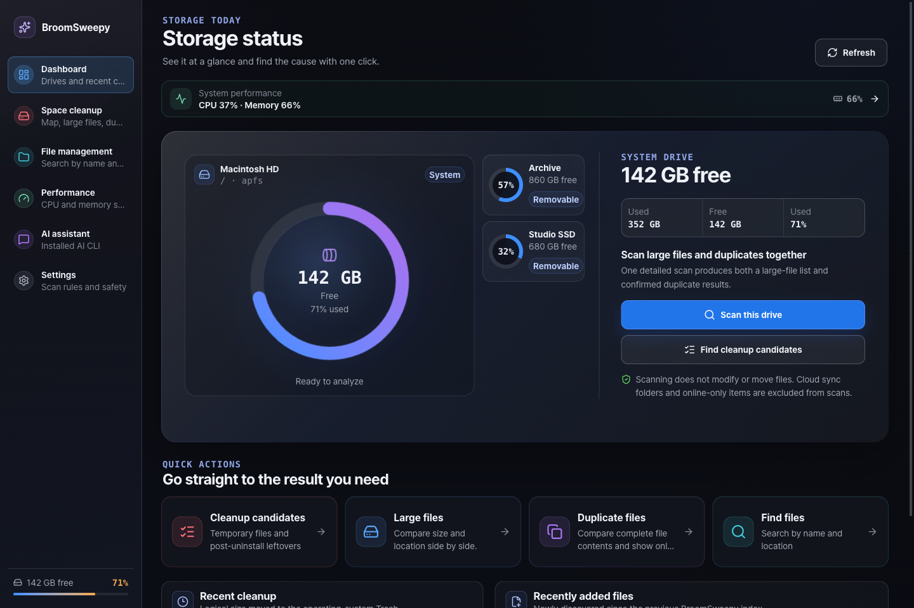
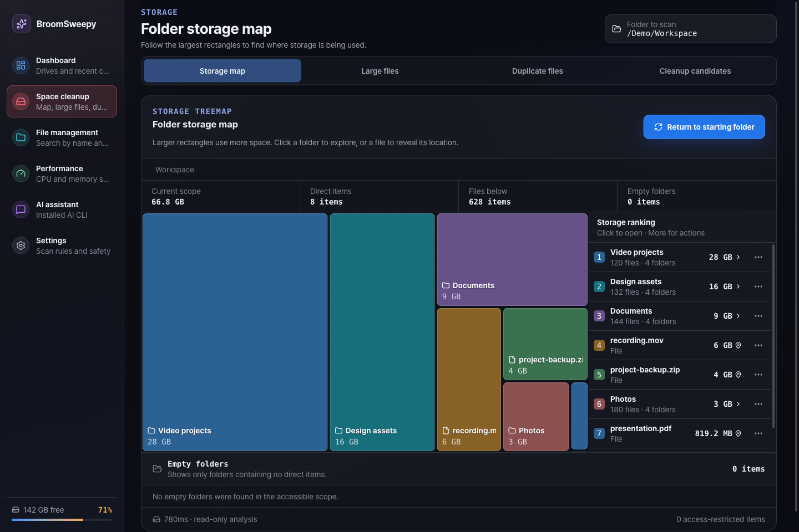
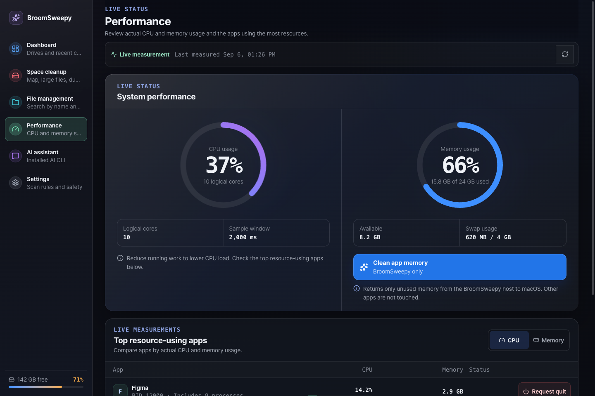
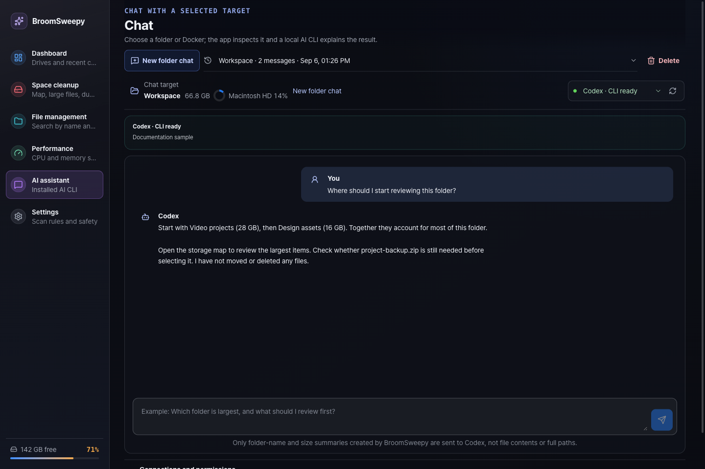
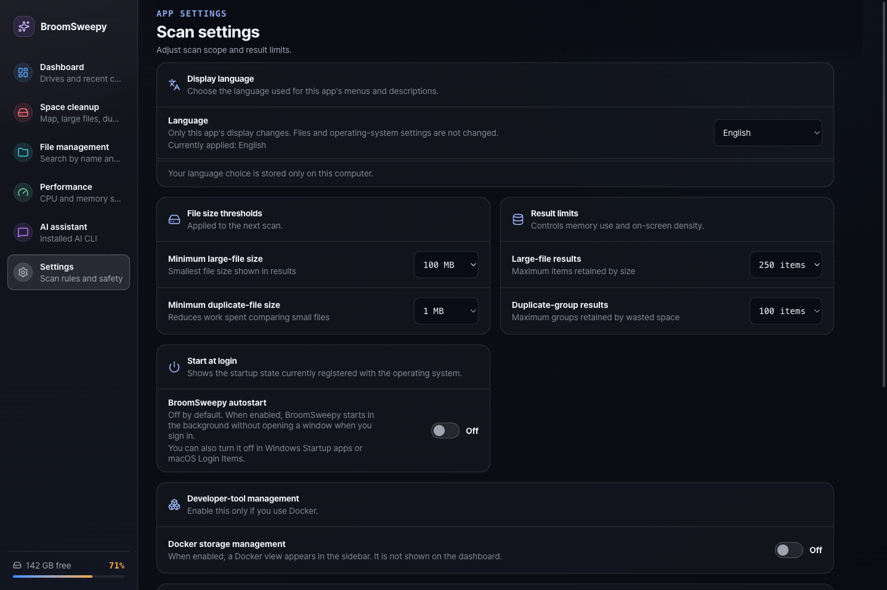

# BroomSweepy — Conversational File Management System

<p align="center">
  
</p>

<p align="center">
  <strong>English</strong> |
  <a href="README.md">한국어</a> |
  <a href="README.ja.md">日本語</a> |
  <a href="README.zh-CN.md">简体中文</a>
</p>

BroomSweepy is a project building a **conversational file management system** for Windows and macOS. Its goal is to make conversation the primary way to find files, scan folders, review candidates, refine conditions, confirm actions, and inspect results in one continuous workflow.

**Rust + Tauri 2 + React is the primary project**, carrying forward the spacious cards, clear icons, and glass-inspired experience of the original SwiftUI app. The Swift source in `BroomSweepy/` remains a legacy reference implementation. Large-file analysis, verified duplicates, and document search run locally in Rust; existing browsing and scanning views remain usable without an AI connection. One installation supports English, Korean, Japanese, and Simplified Chinese; English is the first-run default. Change it under `Settings > Display language`.

## v1.8.1 — menu-bar and language patch · 2026-10-21

- **Mac menu bar**: Restores the top speech-bubble pointer and colored gauges. Only the background uses `alpha 0.82`; text and controls remain fully opaque and readable.
- **Display language**: Fixes missing translations in app-generated warnings, evidence, and results. Notices stored as `key + params` update immediately when the language changes. User filenames, paths, existing conversation text, and the language of macOS-owned windows are not rewritten.
- **Verification scope**: The 216 passing frontend checks, 12 native-component checks, and user-approved material preview apply to the local patched build displaying 1.8.0. At the time of this record, v1.8.1 CI and final installed-app visual checks are pending. These results do not establish completed distribution, native Windows behavior, or long-duration memory stability.

[v1.8.1 release](https://github.com/Dannykkh/bloomsweepy/releases/tag/v1.8.1) · [Patch scope, distribution, and verification status](docs/releases/v1.8.1.md)

## v1.8.0 — features and verification scope · 2026-10-21

The changes below are **the intended scope of v1.8.0 source and new installers**. The existing v1.7.0 tag and assets remain unchanged. Some installed-app/Codex checks on October 21 used the local development build while it still displayed 1.7.0; those observations are not relabeled as end-to-end verification of the new 1.8.0 installer.

[v1.8.0 release and downloads](https://github.com/Dannykkh/bloomsweepy/releases/tag/v1.8.0) · [Release scope, installation and verification notes](docs/releases/v1.8.0.md) · [Changelog](CHANGELOG.md)

| Area | Verified scope |
|---|---|
| Mac interface | Grouped Mac preferences, task-based navigation, and six app-settings categories. Installed app launch, native glass, and change-history navigation checked |
| Real Codex workflow | Largest-item inspection, shared-result treemap, name search, performance/app/Finder inspection, and one approved synthetic file moved to Trash. App-memory cleanup executed through its local confirmation screen |
| Regression checks | 192 frontend tests and TypeScript checking passed. ARM64 build, signing and replacement were verified before the version bump; preference apply/restore and error guards use isolated mocks |
| Still pending | Real Finder writes/restores, successful document-body search, native Windows installation/runtime, and long-duration whole-process memory stability |

[Latest Mac interface verification](docs/qa/mac-design-review-2026-10-21/review.md) · [Installed app/Codex audit and remaining usability issues](docs/qa/2026-10-21-installed-chat-audit.md)

Known usability issues remain in identifying earlier file results after returning to chat and matching document-body disclosure to the current conversation folder. Permission boundaries are not bypassed; not every operation completes with one chat message.

System candidates now keeps its full width, uses one scan action and wraps long paths/evidence. Incomplete-scan warnings appear before candidate selection. Mac developer caches and read-only Windows installation records stay distinct, with existing review acknowledgements and preflight revalidation preserved. [Original installed defect, corrected synthetic screens and 192-test regression](docs/qa/system-candidates-2026-10-21/review.md)

## v1.8.0 — conversational files and folders

Chat Trash moves use one inline **Yes/No** question without a second review dialog or timer deadline. The composer permission control or **Settings → AI & permissions → Connections and permissions → Chat permissions** offers Read only, Confirm before acting (default), and Full access. Read only cannot prepare or execute changes. Explicit Full access permits simple direct removal commands naming every target, such as `delete promo-video`, after target revalidation without another question. Conditional, advisory, quoted, compound, or unsupported phrasing falls back to Yes/No. Ambiguous targets, app-related data, process termination, Docker cleanup, and permanent deletion do not qualify. Preferences follow the existing Session/Remember lifetime, but individual plans and approvals are not restored after restart. Models/MCP receive no execution or automatic-approval tool. [Consent QA](docs/qa/2026-10-05-conversational-trash-consent.md)

Chat keeps the conversation and bottom composer visible, showing actual preparation, waiting, app-query, and analysis stages with elapsed time. Results normally accompany their answer; returning to chat can still place an earlier file result below the latest reply, a known provenance issue. Failures, permission problems, and final review remain expanded. This is not token streaming or an estimated completion percentage. [Chat verification](docs/qa/2026-10-05-chat-workbench.md) · [Latest installed audit](docs/qa/2026-10-21-installed-chat-audit.md)

**Cleanup candidates → Folder tree** supports expanding folders and selecting all or individual items. Parent selection includes descendants; excluding a child prevents moving the parent itself. Enter from the storage map or a measured AI file list, then review exact targets before moving them to Trash. Whole-folder review on this new page strictly checks hidden protected items, links, clouds, and device boundaries. State is capped at 2,048 nodes and rendering at 200 rows; unmeasured, partial, and expired results remain explicit. Checks on the Mac development installation displaying 1.7.0 on October 5, 2026 covered three temporary targets/209B moved to Trash, child preservation, cancellation, rescan, local AI-card entry, and history after restart. Windows, external-model investigation end-to-end, and long-duration memory tests remain pending. [Tree QA](docs/qa/2026-10-05-cleanup-tree.md) · [Native Mac QA](docs/qa/2026-10-05-cleanup-tree-native.md)

Ask “What is the largest folder or data here? Can I delete it?” to freshly measure and rank direct items in the current folder. Folder sizes include descendants; size alone does not establish deletion safety. **View the same results on the storage map** reuses that scan in the treemap. Name-only folder matches remain unmeasured until inspected. Partial results, read failures, and expired snapshots are distinguished. This question neither selects deletion targets nor deletes anything.

Ask the assistant to scan files, find a name, or delete a named folder such as `promo-video`. Rust performs the actual name search, size scan, child-folder browsing, and trash review, including nonempty folders. The same conversation's local cards provide Open, Reveal, selection, final confirmation, and per-item results. Models request app operations; they never receive deletion authority.

Search retains at most 200 results, model/UI pages contain 24, and a trash review allows 100 selected items. Search-only folder sizes are unmeasured, not zero. Ambiguous names or incomplete searches never auto-select a target. Review exact local paths, contents, and logical sizes; the affirmative button explicitly includes descendants. Chat plans are single-use without a timer deadline, and revalidate changes, links, clouds, and protected paths before OS Trash. Permanent deletion, arbitrary shell commands, conversational renaming, ordinary moves, and folder creation are not provided.

These v1.8.0 additions are not in the existing GitHub v1.7.0 downloads. Real Codex scan/nonempty-folder review requests and native macOS Trash moves of synthetic items have been tested. Windows runtime and long-duration resource validation remain pending.

On macOS, symlinks inside a real folder (such as `node_modules/.bin`) move only as links; targets are never followed. Review displays a separate link count and detects retargeting. Linked targets/ancestors, clouds, mount boundaries, and special files remain protected; Windows reparse points/junctions remain blocked. [Development QA](docs/qa/2026-10-04-conversational-files.md)

### Task-based navigation and app settings

Navigation groups **Computer** (Dashboard → Performance → App management → platform-specific Mac/Windows settings), **Files & storage** (Space cleanup → Find files), and **Tools** (AI assistant → optional Docker management), with Settings at the bottom. Other-platform settings stay hidden, and subviews retain their parent selection. Docker management is off by default.

App settings has six categories: General, Scanning & search, AI & permissions, File monitoring, Developer tools, and About. Switching categories preserves settings and in-progress state. Dashboard cleanup shortcuts open system cache/temporary candidates without replacing folder-tree state. Mac settings prioritizes actual controls and history rather than duplicate links to other menus. [Navigation verification](docs/qa/workspace-navigation/verify-report.md)

### macOS — Finder preferences and developer caches

Mac settings reads five preferences: file extensions, hidden files, path bar, status bar, and folders first when sorting by name. **File display** and **Paths and information** group adjacent Off/On draft buttons and Apply. Selection alone does not write; an absent preference leaves both choices unselected. **Preference change history** restores the original value, including its absence. A different current value blocks restoration, but this is not an atomic lock against other applications. Verified storage does not establish visible Finder behavior, and Finder is never restarted automatically.


Captured from the installed app on 2026-10-21, not a design prototype or synthetic settings screen. The grouped layout removes duplicate explanations and overlapping headings. No real Finder preference was changed during this UI inspection. [UI, mocked apply/restore, and installation verification](docs/qa/mac-design-review-2026-10-21/review.md)

Cleanup adds direct entries in Xcode DerivedData unchanged for at least 7 days and iOS DeviceSupport unchanged for at least 30 days. Age does not prove an item unused. These are review candidates that may require rebuilding or downloading again, using the existing selection/revalidation/Trash workflow. Projects, Archives, simulators, Time Machine, and AI models are excluded. Logical candidate size is not guaranteed reclaimed disk space.

Chat and external MCP `macos.inspect` use the same read-only app engine. Writes/restores require local buttons and are not inherited from chat Full access. Apple Intelligence removal, profiles, and background-service control are not supported. These source/development changes are not automatically added to public v1.7.0 or older installations. [Plan and scope](docs/plan/macos-management/plan.md)

### Windows — dedicated inspection and official settings links

Windows has its own settings view with four Explorer and six AI-policy stored values, including separate Recall user/computer scopes, plus eight official settings targets. Missing, wrong-type, and denied reads remain distinct; stored values do not establish whether a feature is effectively on or off. MCP `windows.inspect` shares the read-only engine. There are no registry writes, elevation, forced system-package removal, or Defender changes. Mac reads, regressions, and Windows-adapter cross-checks passed; **native Windows installation/runtime and settings-screen behavior remain unverified**. These changes are not in existing public v1.7.0 assets. [Implementation scope](docs/plan/windows-management/implementation-contract.md) · [Verification](docs/qa/windows-management/verify-report.md)

## v1.7.0 — Conversational tools and resource safeguards

The scope and pending checks below describe the published v1.7.0 release. See above for current development additions and verification.

[Stable release and downloads](https://github.com/Dannykkh/bloomsweepy/releases/tag/v1.7.0) · [Changelog](CHANGELOG.md)

- **Conversational empty-folder cleanup** connects local rescans, candidate cards, conversational exclusions, final confirmation, and per-item results.
- **Folder actions and opening files** add separately reviewed whole-folder Trash moves from the storage map, with distinct Open and Reveal actions.
- **App management** lists installed apps and searches substrings in names, publishers, and paths. Mac app bundles and related data are reviewed separately; Windows uses the operating system's removal page.
- **Empty system Trash** requires separate irreversible confirmation for the user's entire Trash. AI has no authority to invoke it.
- **Resource safeguards** use bounded streaming traversal, index memory/disk budgets, and an isolated document worker.
- **macOS menu bar** uses a native panel for RAM, CPU, and system-disk readings every 10 seconds. The optional RAM title persists. Closing hides the window; Open restores it; Quit/⌘Q exits. No additional WebView is created.

Navigation: **Dashboard → Performance → App management → Space cleanup → File management → AI assistant → Settings**. Docker management is off by default and appears only when enabled.

### Conversational empty-folder workflow

1. Select a local folder in AI assistant and ask to scan for empty folders.
2. Review the app's refreshed candidate card and exclude folders through chat or checkboxes.
3. Review the exact paths and selection, then use the **final confirmation button** to move them to Trash.
4. Check each item's completed, failed, or skipped result.

Review is limited to 200 candidates and each AI page to 24. Counts identify omissions due to protection, changes, or limits. Plans are single-use, expire after five minutes, and are invalidated by selection changes, rescans, or restarts. A chat message or AI response cannot grant final approval. General file moves and renaming through conversation are not supported yet. **End-to-end validation of the new tool flow with a real Codex CLI is still pending.**

### App management and opening files

`App management` lists apps without a full-drive scan. On Mac, use the app's official uninstaller first; ordinary app bundles can be moved to Trash after separate confirmation. Related data cleanup is a separate opt-in review limited to caches and preferences matched by exact app identifier. Documents, Application Support, Containers, and shared data are excluded from automatic candidates. Windows opens the official Installed apps removal page; BroomSweepy does not guess and delete app folders, registry entries, or AppData. Opening that page does not mean removal has completed.

Explicit Open actions launch ordinary documents/media in their default viewer and ordinary folders in the file manager. Executables, scripts, and app packages are revealed instead of executed. Reveal location and in-app folder drilldown remain separate actions. These features do not grant new removal permissions to AI, CLI, or MCP.

### Local processing, tokens, and transmitted data

File searches, scans, aggregation, and candidate management run on your computer, with bounded summaries sent to AI. Local file operations themselves do not use LLM tokens. The potential saving comes from sending relevant summaries instead of complete file lists—not from Rust itself. A well-designed general CLI can be similarly efficient; savings for equivalent completed tasks have not been measured.

Cloud AI providers receive names, sizes, counts, candidate IDs, questions, and chat history. App-generated folder summaries and new candidate pages do not automatically contain file bodies or full paths, but paths or contents you type can be included in questions and history. A local CLI or read-only permission does not mean fully offline processing or guaranteed prevention of data transmission. Separately authorized MCP file/document searches may return paths and matching snippets. No zero-transmission or fixed token-saving claim is made.

### Resource boundaries and verification limits

Heavy work stops cooperatively above 512 MiB of host-process memory or below 256 MiB of available system RAM. PDF/Office workers use a 128 MiB Rust-allocation budget and a 15-second limit. Failed indexing preserves the last completed index. These are not whole-app/WebView/CLI OS memory quotas or proof that memory leaks are resolved. Hiding the main window retains its existing state and memory.

- Local automated checks: 273 Rust and 43 frontend tests passed; one opt-in live CLI diagnostic skipped.
- Not yet verified: the new real-Codex tool flow, long-running whole-process memory stability, real user-app deletion, and actual Trash emptying.
- Menu-bar preference persistence, restart, and full quit were checked. Direct icon clicks, popover controls, and keyboard interaction still need visual verification.
- Total app size, installation date, and selectable name/date/size sorting are not implemented. Substring search is available.
- Windows installers and automated checks are built in CI. Passing CI does not prove interactive installation, GUI, or Recycle Bin behavior.

## Historical release screenshots · v1.6.0

These historical v1.6.0 captures render actual React components with synthetic documentation data. They do not show v1.7.0 navigation, app management, new confirmation flows, or the native menu bar. Drives, files, metrics, and conversations are examples, not real AI responses or user files. Browser captures do not reproduce macOS native window materials.

### Multi-drive dashboard



### Storage treemap



### CPU and memory



### AI assistant



### Settings and display language



## What's new in v1.6.0

- Dark glass-inspired surfaces, prominent action buttons, clear icons, and streamlined navigation.
- A large selected-drive card beside compact drive cards. Selecting another drive exchanges their positions and sizes with an animated transition.
- CPU and memory rings, top-app usage, smooth transitions between samples, and reduced-motion support.
- macOS app-memory cleanup returns only unused allocator pages from the BroomSweepy host process. Zero bytes returned is a valid completion.
- Treemap navigation and individual-file actions with identity/path revalidation and a Trash-operation journal.
- Distinct missing, broken, incompatible, and sign-in-required AI CLI states, plus improved conversation, cancellation, and saved-history handling.

## Safety and cloud exclusions

Scans do not modify files. Large-file/duplicate scans, drive summaries, treemaps, file catalogs, and document indexes exclude known cloud-sync roots and online-only entries. The policy prunes macOS `~/Library/CloudStorage`, `~/Library/Mobile Documents`, and recognized Google Drive, iCloud, OneDrive, and Dropbox paths before traversal; selecting a recognized cloud root directly is also rejected. Even downloaded files inside recognized cloud roots are excluded. Arbitrarily relocated sync folders and every possible provider cannot be identified reliably.

Duplicates pass size grouping, partial/full BLAKE3, and final byte comparison. File moves require selection, revalidation, final confirmation, and journaling before using the OS Trash or Recycle Bin. v1.7.0 empty-folder moves require separate final confirmation. Empty system Trash is a distinct irreversible exception described below. Trashed logical bytes do not equal newly available disk space. Automatic registry deletion is not provided.

v1.7.0 adds `Open Trash` and `Empty system Trash` above storage views. The latter asks the OS to empty the current user's Trash across connected drives, including items from other apps, not just the selected folder. It requires a separate warning, acknowledgment checkbox, and single-use confirmation valid for 2 minutes. It is not exposed to AI/CLI/MCP, does not pre-scan the entire Trash, and does not guarantee freed space. The warning dialog and cancellation were checked in a local Mac installation; actual native emptying was not performed.

Memory cleanup does not purge system RAM, other apps, WebView helper processes, swap, or memory leaks. There is no CPU-cleanup action. On macOS, requesting a normal app exit is a separate confirmation flow with no force-kill fallback. Windows performance is read-only; swap is a commit-based estimate, not current pagefile usage.

Docker management is off by default. When enabled, cleanup uses fixed commands, excludes volumes, and requires a separate irreversible-action confirmation.

## AI, CLI, and MCP

The development build shares preferences between the composer's **[CLI] [Model · Reasoning effort]** controls and **Settings → AI & permissions → AI model**. Switching between Codex, Claude Code, AGY, Grok, and Ollama restores that provider's model and per-model effort. Codex, Claude Code, Grok, and Antigravity use actual CLI model/support metadata; Ollama lists installed models. Unsupported effort levels are not invented. Choices stay on this computer without changing global CLI settings, sign-in, or removal permissions. A listed model does not guarantee account access, and errors never silently switch models. Missing CLIs block questions with an installation-needed state. This is separate from public v1.7.0. [Model-selection contract](docs/architecture/assistant-model-selection.md)

Explicit models offer **Reasoning effort** from each CLI model's supported levels, remembered per model. The default delegates to the CLI; an unsupported saved choice blocks sending until deliberately changed. Updates do not replace selected models. The 2026-10-06 check of CLI0.160.1 on this Mac found seven visible models including GPT-6.1-Sol; this is dated evidence, not a current model-catalog guarantee. [Reasoning-selection verification](docs/qa/2026-10-06-cli-reasoning-selection.md) · [Provider switching](docs/qa/2026-10-08-composer-provider.md)

The LLM chooses app inspections and analyzes the app's actual results, requesting further queries when needed. In-app chat sends structured CLI requests (JSON) to the common app dispatcher; it does not traverse the external MCP wire. External MCP shares the same [capability contract](docs/architecture/app-capability-contract.md) and app engine. Changes follow the permission mode, target revalidation, and operation-specific confirmations. Real Mac Codex workflows and the installed sidecar's read-only stdio checks passed separately, not every feature/provider end-to-end. [Actual verification and limits](docs/qa/2026-10-21-installed-chat-audit.md)

Installing the Codex desktop app does not establish that the Codex CLI is installed. Check your provider's CLI installation, compatible version, and sign-in state in BroomSweepy. See the status table for current Mac development checks; historical v1.7.0 pending checks remain in its release section. Claude Code, Grok, Antigravity, and Ollama adapters have not all been live-tested for this Mac development build.

In-app chat sends a bounded folder summary containing item names and sizes, plus your question and conversation history, to the selected provider. A local CLI does not mean offline model processing. MCP cleanup tools expose anonymous candidate IDs and bounded summaries, with no approval or deletion-execution tools. Separately enabling file or document search can expose paths and matching excerpts to external clients. Actual file actions follow the app's permission, revalidation, and confirmation rules.

## Platforms and development

Requirements: Rust stable, Node.js 22+, and npm; WebView2 and MSVC Build Tools on Windows; Xcode Command Line Tools on macOS.

- `apps/desktop/`: primary Tauri/React app
- `crates/bloomsweepy-core/`: shared Rust analysis engine
- `crates/bloomsweepy-control/`, `apps/bloomsweepy-mcp/`: local control protocol and CLI/MCP bridge
- `BroomSweepy/`: legacy SwiftUI reference

These features were implemented and partly checked in a local Apple Silicon development build. See the verification limits above. Windows installers are built in CI; native Windows runtime checks remain separate. Mac builds are ad-hoc signed and not Apple-notarized. See [Releases](https://github.com/Dannykkh/bloomsweepy/releases) for downloads and platform notes.

```sh
cd apps/desktop
npm ci
npm run tauri dev
```

```sh
# Repository root
cargo fmt --all -- --check
cargo clippy --workspace --all-targets -- -D warnings
cargo test --workspace
cd apps/desktop
npm run check
npm run test:all
npm run build
npm run tauri build
```

## Documentation

[Changelog](CHANGELOG.md) · [CLI connection and control](docs/cli-control.md) · [Performance and memory boundaries](docs/architecture/startup-memory-status.md) · [Safe Trash actions](docs/architecture/safe-trash-actions.md) · [Document search](docs/architecture/document-search.md) · [File search](docs/architecture/fast-file-search.md) · [Design](DESIGN.md) · [Reproduce screenshots](docs/assets/screenshots/README.md)

## Important: data loss and recovery responsibility

BroomSweepy is designed to act only on items the user selected and confirmed. Recovery can still depend on operating-system permissions, Trash settings, sync services, and external or network-drive behavior. Docker cleanup does not use the operating-system Trash and completed steps cannot be restored.

Back up important data and verify every selected path, file, and Docker category before running cleanup. The project providers and contributors are not responsible for data loss or failed recovery caused by user-initiated file moves, deletion, Trash emptying, or Docker cleanup, except where liability cannot legally be excluded.
