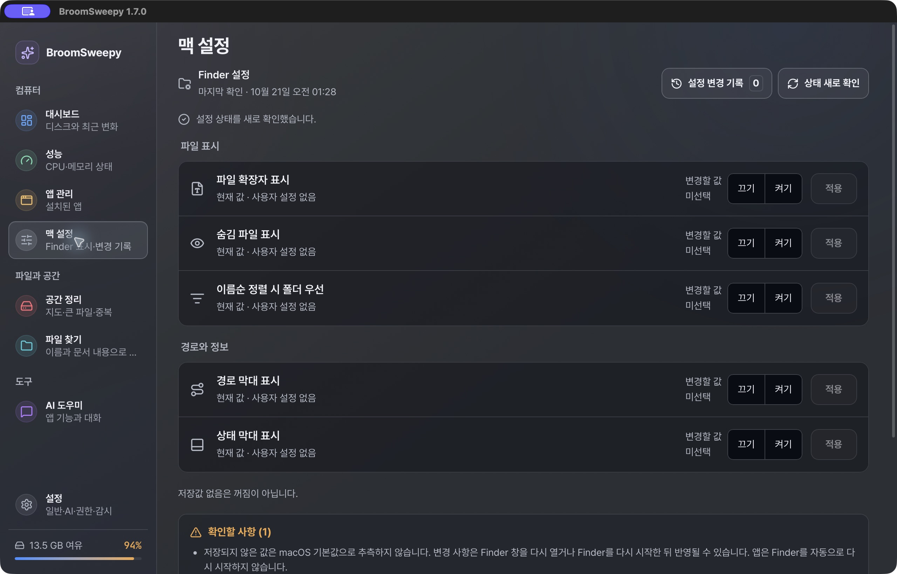
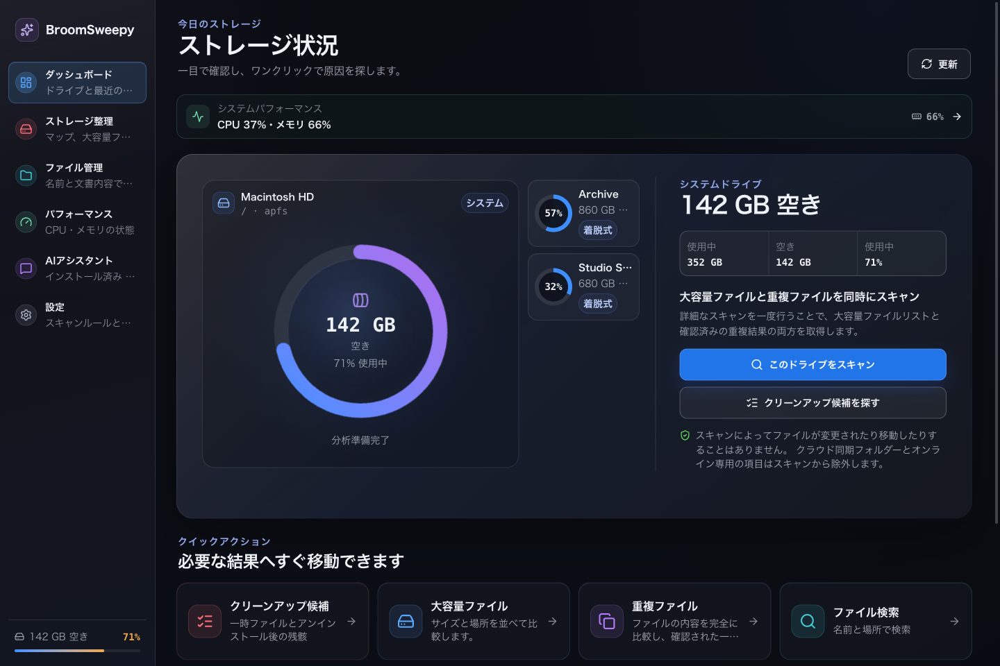
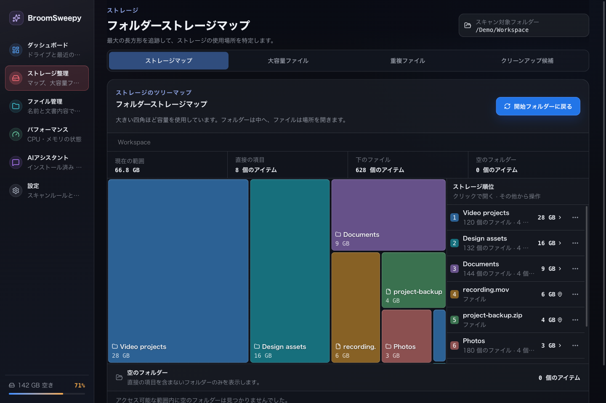
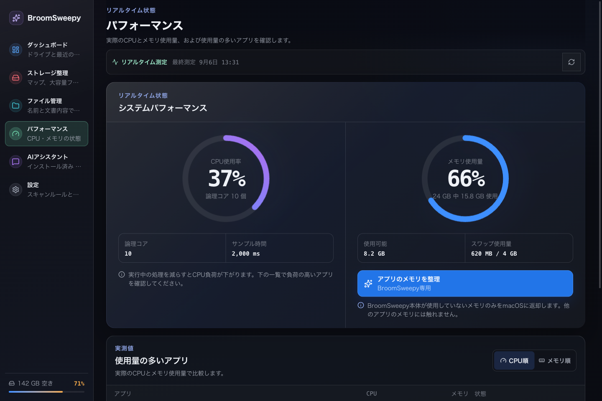
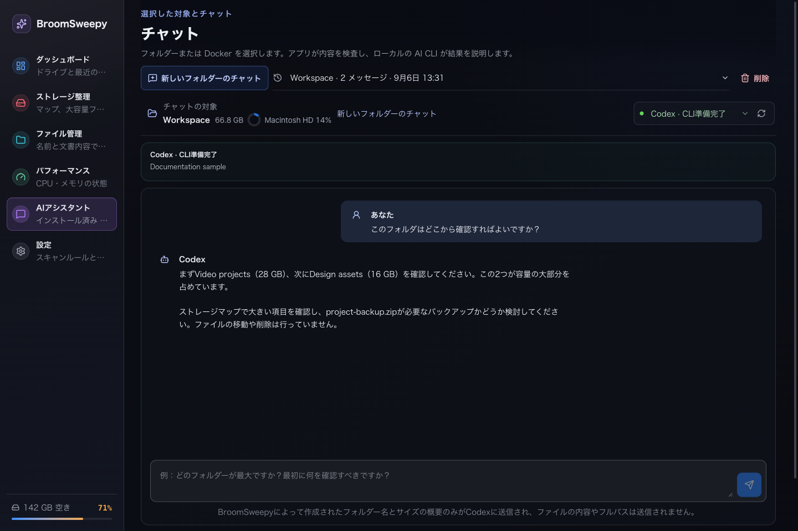
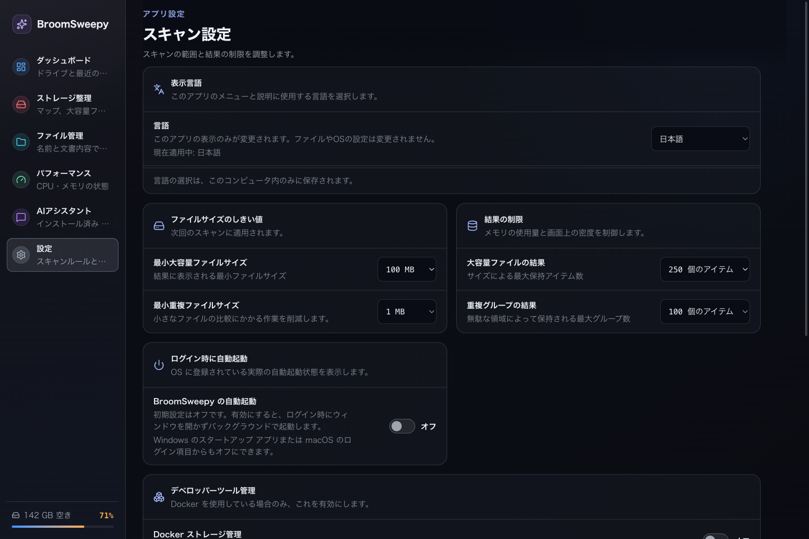

# BroomSweepy — 対話型ファイル管理システム

<p align="center">
  
</p>

<p align="center">
  <a href="README.en.md">English</a> |
  <a href="README.md">한국어</a> |
  <strong>日本語</strong> |
  <a href="README.zh-CN.md">简体中文</a>
</p>

BroomSweepyは、WindowsとmacOS向けの**対話型ファイル管理システム**を開発するプロジェクトです。会話を主な操作方法として、ファイル検索からスキャン、候補の検討、条件の調整、最終確認、実行結果の確認までを一つの流れで進められる体験を目指しています。

**Rust + Tauri 2 + Reactがメインプロジェクト**となり、従来のSwiftUIアプリの広々としたカード、分かりやすいアイコン、ガラス調のUIを受け継ぎます。`BroomSweepy/`のSwiftソースは従来版の参考実装です。大容量ファイル、内容を検証した重複ファイル、文書検索はローカルのRustエンジンで処理し、既存の閲覧・スキャン画面はAI接続なしでも利用できます。1つのアプリで英語・韓国語・日本語・簡体字中国語に対応し、初回は英語で表示します。`Settings > Display language`で変更できます。

## v1.8.1 — メニューバーと言語表示の修正 · 2026-10-21

- **Macメニューバー**：上部の吹き出しの突起とカラーゲージを復元しました。背景にだけ`alpha 0.82`を適用し、文字と操作部は不透明のまま読みやすさを保ちます。
- **表示言語**：アプリが生成する警告・根拠・結果の翻訳漏れを修正しました。`key + params`で保持する案内は言語変更時にすぐ再表示します。ユーザーのファイル名・パス・既存の会話原文や、macOS自身のウィンドウの言語は書き換えません。
- **検証の区別**：フロントエンド216件・ネイティブコンポーネント12件の検査成功と、質感プレビューのユーザー承認は、表示バージョン1.8.0のローカル修正版での記録です。この記録の作成時点ではv1.8.1のCIと新しいインストール版の最終画面確認は未完了です。配布完了、Windows実機での動作、長時間のメモリ安定性を保証するものではありません。

[v1.8.1リリース](https://github.com/Dannykkh/bloomsweepy/releases/tag/v1.8.1) · [修正範囲と配布・検証状況](docs/releases/v1.8.1.md)

## v1.8.0 — 機能と検証範囲 · 2026-10-21

以下は**v1.8.0の対象ソース**に含まれる改善です。既存のGitHub v1.7.0配布ファイルはそのまま残し、これらの改善は新しいv1.8.0インストール版に含めます。正式版のビルド・CI・アップロードは進行中であり、この説明は配布完了を意味しません。

[v1.8.0リリース](https://github.com/Dannykkh/bloomsweepy/releases/tag/v1.8.0) · [v1.8.0リリースノート](docs/releases/v1.8.0.md)

2026-10-21のMacインストール・チャット検証は、**表示バージョン1.7.0のARM64開発版で行った履歴**です。新しいv1.8.0配布バイナリのインストール検証としては扱いません。

| 区分 | 確認した範囲 |
|---|---|
| v1.8.0の画面 | 機能別のMac設定、作業中心のサイドバー、6分類のアプリ設定、全幅のシステム候補画面 |
| Mac・Codexの実測履歴（表示1.7.0） | 大きい項目の取得、同じ結果の容量マップ、名前検索、パフォーマンス・アプリ・Finderの参照、許可された合成ファイル1件のゴミ箱移動を確認。メモリ整理はローカル確認画面で実行。Mac A画面のビルド・署名・入れ替え・変更記録への移動も確認 |
| 現在のソースの自動回帰 | フロントエンド192件成功、型検査成功。設定の適用・復元とエラー時の保護、システム候補の表示・操作は隔離した模擬試験で検証。v1.8.0の配布ビルド・CI・アップロードの成功を示すものではありません |
| 残る検証 | 実際のFinder設定の書き込み・復元（NOT RUN）、文書本文検索の成功経路、Windows実機・インストール、長時間の全プロセスメモリ安定性 |

[Mac A画面の検証履歴](docs/qa/mac-design-review-2026-10-21/review.md) · [インストール・Codexチャット検証履歴と残る操作性の問題](docs/qa/2026-10-21-installed-chat-audit.md) · [システム候補画面の修正QA](docs/qa/system-candidates-2026-10-21/review.md)

既知のP2の操作性課題は2件です。画面に戻った際の以前のファイル取得結果の出典表示と、文書本文の公開範囲を現在の会話フォルダに合わせる導線が残っています。権限による制限を回避したり、すべての操作がチャット1回で完了すると説明したりはしません。

## v1.8.0 — 会話によるファイル・フォルダ管理

内蔵チャットのゴミ箱移動は別の確認ポップアップを挟まず、**はい・いいえの1回**で決めます。待ち時間だけでは確認を失効させません。入力欄の**権限選択**、または**設定 → AI・権限 → 接続と権限 → チャット権限**から、`閲覧のみ`・`確認してから実行`（初期値）・`フルアクセス`を選びます。閲覧のみでは変更の準備も実行もしません。フルアクセスを明示的に選ぶと、`promo-videoを削除して`のように全対象名を指定した、単純で直接的なファイル・フォルダ・アプリ本体の削除命令は再検証後に処理します。条件付き・相談・引用・複合文や未対応の表現は、はい・いいえで確認します。「削除してもいい？」、曖昧な対象、関連データ、プロセス終了、Docker整理、完全削除はこの自動実行権限の対象外です。設定の選択は既存の権限保持方法に従いますが、個別の計画・承認は保存しません。MCPやモデルに実行ツールを追加するものではありません。[確認フローQA](docs/qa/2026-10-05-conversational-trash-consent.md)

フルアクセスではフォルダの会話を開いてから、**ローカルドライブ一覧**や会話でローカルボリュームを参照し、全体の名前検索で見つけた正確な対象を既存のファイル管理カードで開けます。検索には時間・件数・メモリの上限があり、クラウド・ネットワークの場所や別のマウント先をたどりません。読み取れない項目や制限に達した結果は部分結果として示し、自動のゴミ箱移動には使いません。このモードはmacOSのフルディスクアクセス、文書本文の公開、外部MCP権限、完全削除の権限を付与しません。従来の確認省略設定をフルアクセスへ自動移行することもありません。[権限モードの検証](docs/qa/2026-10-11-chat-access.md)

会話画面は中央の履歴と、常に表示する下部入力欄で構成します。CLI準備・応答待ち・アプリへの問い合わせ・結果分析の段階と経過時間を表示し、応答を中断できます。取得一覧はその回答に付けて折りたたみ、最終確認・失敗・権限不足は初期状態で開きます。ただし画面に戻ると以前のファイル結果が最新回答の下に現れる既知の問題があり、出典表示の改善が必要です。完了した確認は処理要約として残し、失敗も会話に表示して、該当の質問を明示的に再試行できます。接続と権限は設定と会話対象の横のボタンで確認します。トークンのストリーミングや推定進捗率の表示ではありません。v1.8.0のUIであり、既存のv1.7.0配布ファイルは変わりません。[チャット検証記録](docs/qa/2026-10-05-chat-workbench.md) · [応答・カードの寿命の検証](docs/qa/2026-10-11-chat-response-timeline.md)

**整理候補 → フォルダツリー**で下位フォルダを展開し、全体または個別に選択できます。親の選択は配下にも適用されますが、子を外した場合は親フォルダ自体を移動しません。容量マップやAIの測定済み一覧から同じ検査結果を開き、最終確認後にゴミ箱へ移動します。この新しいページでは隠れた保護項目・リンク・クラウド・別デバイスを厳密に検査します。状態は最大2,048ノード、表示は200行に制限し、未測定・部分結果・期限切れを明示します。2026-10-05、表示バージョン1.7.0のMac開発版で一時資料3対象209Bの移動、子ファイル保持・キャンセル・再検査・AIローカルカードからの移動・再起動後の履歴を検証しました。Windows・外部モデルの調査全体・長時間メモリ検証は未実施です。[ツリー検証記録](docs/qa/2026-10-05-cleanup-tree.md) · [Mac実機検証](docs/qa/2026-10-05-cleanup-tree-native.md)

「ここで最も容量の大きいフォルダやデータは？削除してもいい？」と聞くと、現在のフォルダ直下の項目を新しく測定し容量順に表示します。フォルダの容量は配下の合計で、容量だけでは削除の安全性を判断できません。**同じ結果を容量マップで見る**で同じ検査をツリーマップに再利用します。名前だけで見つけたフォルダは内容を検査するまで未測定です。部分結果、読み取り失敗、期限切れを区別し、この質問だけでは削除対象の選択や削除を行いません。

AIに検査、名前検索、`promo-video`などのフォルダ整理を依頼すると、Rustアプリが検索・容量計算・下位探索・ゴミ箱移動の確認を行います。空でないフォルダも対象です。同じ会話のカードで開く・場所の表示・選択変更・最終確認・項目別結果を扱います。AIに任意の削除権限を渡すのではなく、アプリの検証済みゴミ箱ルーチンを利用します。

名前検索は最大200件、AIと画面は24件ずつ、移動確認は最大100件です。未検査のフォルダ容量は未測定と表示します。同名項目や不完全な検索から対象を自動選択しません。フルパス・内容・論理サイズを示し、基本のはい・いいえの質問ではフォルダ配下の内容も一緒に移動することを案内します。チャットの計画に時間制限はなく、1回限り使用でき、選択変更・再検査・再起動で無効になります。実行直前に変更・リンク・クラウド・保護パスを再検証します。完全削除、任意シェル、会話での名前変更・通常の移動・フォルダ作成は提供しません。

v1.8.0の対象ソースに含まれる追加機能で、既存GitHub v1.7.0の配布物には含まれません。実際のCodexの検査/空でないフォルダ確認要求と、合成項目のmacOSゴミ箱移動は、表示1.7.0の開発版で検証した履歴です。Windows実機と長時間の資源検証は未実施です。

macOSでは実フォルダ内部の`node_modules/.bin`などのシンボリックリンクはリンク自体のみ移動し、リンク先をたどりません。確認カードに件数を表示し、リンク先の変更も再検査します。選択対象/親のリンク、クラウド・別デバイス・特殊項目の保護は維持し、Windowsの再解析ポイント/ジャンクションは引き続き拒否します。[開発版検証記録](docs/qa/2026-10-04-conversational-files.md)

### 作業中心のメニューとアプリ設定

メニューを**コンピュータ**（ダッシュボード → パフォーマンス → アプリ管理 → OS別のMac設定/Windows設定）、**ファイルと容量**（ストレージ整理 → ファイル検索）、**ツール**（AIアシスタント → 任意で有効にするDocker管理）に分け、設定は下部に配置します。他のOSの設定メニューは表示しません。下位画面でも対応する親メニューを現在位置として示します。Docker管理は初期状態で無効です。

**アプリ設定**は、一般 / 検査・検索 / AI・権限 / ファイル監視 / 開発者ツール / 情報の6分類です。分類を切り替えても設定値や進行状態は初期化しません。ダッシュボードは実際のドライブ名・容量と検査・クイック操作を簡潔に表示し、整理候補への導線はシステムキャッシュ・一時ファイル一覧に直接つながります。Mac設定には重複する他メニューへのショートカットを置かず、設定操作と変更記録を先に示します。フォルダツリーは別に維持します。[メニュー・設定の検証](docs/qa/workspace-navigation/verify-report.md)

**システム候補**の入れ子レイアウトを全幅・1列に修正し、初回のスキャン操作を1つにしました。部分結果の警告は要約・フィルター・選択より先に表示し、OS別の説明・フィルターと長いパスの折り返しも調整しました。開発用キャッシュの再ビルド・再ダウンロード警告、検討の確認、最終確認、実行前の再検証は維持します。模擬画面でのQAであり、実際の削除やWindows実機の検証ではありません。[修正と検証範囲](docs/qa/system-candidates-2026-10-21/review.md)

### macOS — Mac設定と開発用キャッシュ

macOSの`Mac 設定`で、ファイル拡張子・隠しファイル・パスバー・ステータスバー・フォルダ優先表示の5設定を参照できます。`ファイルの表示`と`パスと情報`の2グループで`オフ`・`オン`から変更値を選び、横の`適用`で保存します。選ぶだけでは変更せず、未設定なら両方とも未選択です。上部の`設定変更の記録`から、変更前の保存値がなかった場合も`元の設定に復元`できます。現在値がアプリの適用値と違う場合は復元を拒否しますが、他のプログラムとの同時変更まで原子的に防ぐものではありません。未設定はオフとは異なり、保存の確認はFinder画面への反映完了を意味しません。Finderを自動再起動しません。



2026-10-21、表示バージョン1.7.0のARM64開発版で取得した実画面です。比較用のデザイン案や合成設定画面ではありませんが、v1.8.0配布版のインストール検証を示す画像でもありません。タイトルの重なりと重複案内を減らし、状態・変更値・適用ボタンを並べました。この画面確認中に実際のFinder設定値は変更していません。[画面・適用/復元の模擬試験・インストール検証の履歴](docs/qa/mac-design-review-2026-10-21/review.md)

ストレージ整理に、7日以上更新されていないXcode DerivedDataと、30日以上更新されていないiOS DeviceSupportの直下の項目を追加しました。更新日が古くても、未使用とは限りません。再ビルド・再ダウンロードが必要になる場合があるため確認候補として示し、既存の選択・再検証・ゴミ箱移動の流れを使います。プロジェクト・Archives・シミュレータ・Time Machine・AIモデルはこの候補に含めません。候補の論理サイズは実際に確保できるディスク容量ではありません。

チャットと外部MCPの`macos.inspect`は、同じアプリエンジンで設定状態を参照するだけです。設定変更はローカル画面の適用・復元ボタンからのみ行い、チャットの`フルアクセス`でも自動実行しません。Apple Intelligenceの削除、プロファイル、バックグラウンドサービスの制御には対応しません。この変更はv1.8.0の対象ソースに含まれ、既存のv1.7.0配布物を置き換えるものではありません。[計画と範囲](docs/plan/macos-management/plan.md)

### Windows — 専用の設定参照と公式設定への接続

v1.8.0の対象ソースはWindowsに**Windows設定**を別途表示します。エクスプローラー4項目・AIポリシー6項目（Recallのユーザー用とコンピュータ用は別）の固定されたレジストリ保存値を参照し、8つの公式Windows設定画面に接続します。保存値なし・型の不一致・アクセス拒否を区別し、保存値から機能が実際にオンかオフかを推定しません。AI/MCPの`windows.inspect`も同じ読み取りエンジンを使います。レジストリ書き込み、管理者権限への昇格、システムパッケージの強制削除、Defenderの変更は行いません。Macでの実際の読み取り、回帰検証、Windowsアダプターのクロス型検査は成功しましたが、**実際のWindowsでの実行・インストール・設定画面の表示は未検証**です。既存のv1.7.0配布物は変わりません。[実装範囲](docs/plan/windows-management/implementation-contract.md) · [検証記録](docs/qa/windows-management/verify-report.md)

## v1.7.0 — 対話型ツールとリソース保護

以下の範囲と未検証項目は公開v1.7.0当時の状態です。現在の開発版については上の節を参照してください。

[正式リリースとダウンロード](https://github.com/Dannykkh/bloomsweepy/releases/tag/v1.7.0) · [変更履歴](CHANGELOG.md)

- **対話型の空フォルダ整理**：ローカル再検査、候補カード、会話による除外、最終確認、項目別の結果を接続しました。
- **フォルダ操作とファイルを開く機能**：容量マップからフォルダ全体のゴミ箱移動を個別に確認し、「開く」と「場所を表示」を区別します。
- **アプリ管理**：名前・提供元・パスの部分一致検索に対応。Macは本体と関連データを別々に確認し、WindowsはOSの削除画面を開きます。
- **システムのゴミ箱を空にする**：ユーザーのゴミ箱全体を対象とする完全削除で、別途確認が必要です。AIにはこの権限を渡しません。
- **リソース保護**：上限付きストリーミング探索、索引のメモリ・ディスク予算、独立した文書処理プロセスを追加しました。
- **macOSメニューバー**：RAM・CPU・システムディスクを10秒ごとにネイティブパネルで表示します。RAM数値の表示設定を保存し、閉じると非表示、開くと復元、終了/⌘Qで完全終了します。追加のWebViewは作成しません。

メニュー順は **ダッシュボード → パフォーマンス → アプリ管理 → ストレージ整理 → ファイル管理 → AIアシスタント → 設定**。Docker管理は初期状態で無効です。

### 対話型空フォルダ整理の使い方

1. AIアシスタントでローカルフォルダを選び、空フォルダの検査を依頼します。
2. 再検査した候補カードを確認し、会話またはチェックボックスで残すフォルダを除外します。
3. 正確なパスと選択内容を確認し、**最終確認ボタン**でゴミ箱移動を実行します。
4. 項目別の成功・失敗・スキップを確認します。

候補は最大200件、AIに渡す1ページは最大24件です。保護・変更・上限による除外数を表示します。計画は5分間有効な使い切りで、選択変更・再検査・再起動により無効になります。会話やAIの返答だけでは実行しません。一般ファイルの移動・名前変更を会話で行う機能は未対応です。**実際のCodex CLIを使った新ツールのエンドツーエンド検証は未完了です。**

### アプリ管理とファイルを開く操作

`アプリ管理`で全ドライブの検査なしに一覧を表示します。Macは専用アンインストーラを優先し、通常のアプリ本体のみ個別確認後にゴミ箱へ移動します。関連データは正確なアプリ識別子に一致するキャッシュと環境設定だけを別途選択・確認します。書類、Application Support、Containers、共有データは自動候補から除外します。Windowsは正式な「インストールされているアプリ」の削除画面を開き、アプリフォルダ・レジストリ・AppDataの推測削除は行いません。画面が開いても削除完了を意味しません。

「開く」は通常の書類・メディアを既定のアプリで、通常のフォルダをファイルマネージャで開きます。実行ファイル・スクリプト・アプリパッケージは実行せず場所を表示します。場所の表示とアプリ内の下位フォルダ探索は別の操作です。AI・CLI・MCPへの削除権限追加はありません。

### ローカル処理・トークン・送信範囲

検索・検査・集計・候補管理は手元のコンピューターで行い、AIには上限付きの要約を渡します。ローカルのファイル操作自体はLLMトークンを使いません。節約の要因はRustではなく、全ファイル一覧の代わりに必要な要約を送ることです。適切に構成した一般CLIでも同程度の効率が得られます。同じ作業を完了する条件での削減率は未測定です。

クラウドAIには名前・サイズ・件数・候補番号と質問・会話履歴が送信されます。アプリのフォルダ要約と新しい候補ページに本文・フルパスは自動挿入しませんが、直接入力したパスや内容は質問・履歴に含まれ得ます。ローカルCLIや読み取り専用権限は、完全オフラインや外部送信の完全防止を意味しません。別途許可したMCPファイル・文書検索ではパスや一致箇所が返る場合があります。外部送信ゼロや一定のトークン削減率は保証しません。

### リソースの範囲と検証の制限

本体メモリ512 MiB超過、またはシステム空きRAM256 MiB未満で重い処理を協調的に中断します。PDF・Office処理はRust割り当て128 MiBと15秒の制限を使用し、索引更新に失敗した場合は前回完了した索引を保持します。アプリ全体・WebView・CLIに対するOSのハード上限でも、メモリリーク解消の保証でもありません。ウインドウを隠しても状態とメモリは保持します。

- ローカル自動検査：Rust273件・フロントエンド43件成功。任意の実CLI診断1件は未実行。
- 未検証：新しいCodexツール連携、長時間の全プロセスメモリ安定性、実際のユーザーアプリ削除・ゴミ箱の完全消去。
- メニューバー設定の保存・再起動・完全終了は確認済み。アイコンの直接クリック、パネル内操作、キーボードの視覚検証は残っています。
- アプリ全体の容量・インストール日・名前/日付/容量による並べ替え選択は未対応。部分一致検索は利用できます。
- Windowsのインストーラーと自動検査はCIで実行します。CI成功は実際のインストール・GUI・ゴミ箱操作の検証を意味しません。

## 過去の公開版の画面 · v1.6.0

以下はv1.6.0時点のReactコンポーネントをサンプルデータで描画した参考画像です。v1.7.0のメニュー・アプリ管理・確認フロー・メニューバーは反映していません。ファイル・数値・会話は例であり、実際のAI応答や利用者のファイルではありません。macOSネイティブ材質も再現していません。

### 複数ドライブのダッシュボード



### ストレージツリーマップ



### CPUとメモリ



### AIアシスタント



### 設定と言語



## v1.6.0の主な更新

- ガラス調のダークUI、大きな操作ボタン、分かりやすいアイコンと整理されたナビゲーション。
- 選択したドライブを大きなカード、他を小さなカードで表示し、選択時に位置とサイズをアニメーションで交換します。
- CPU・メモリの円形グラフ、上位アプリの使用量、測定間の滑らかな遷移とモーション軽減への対応。
- macOSのアプリメモリ整理はBroomSweepy本体の未使用allocatorページだけをOSに返します。返却量0も正常な完了です。
- ツリーマップと個別ファイル操作、ファイルの同一性・パスの再検証、ゴミ箱操作の記録。
- AI CLIの未導入・実行不可・非互換・ログイン必要を区別し、会話、キャンセル、保存履歴の処理を改善しました。

## 安全性とクラウドの除外

スキャンはファイルを変更しません。大容量・重複検査、ドライブ集計、ツリーマップ、ファイル一覧、文書索引は既知のクラウド同期ルートとオンライン専用項目を除外します。macOSの`~/Library/CloudStorage`、`~/Library/Mobile Documents`と認識済みのGoogle Drive・iCloud・OneDrive・Dropboxパスは走査前に除外し、直接選択しても検査しません。認識済みルート内のダウンロード済みファイルも除外します。任意の場所へ移動した同期フォルダや、すべてのプロバイダーの自動識別は保証しません。

重複はサイズ、部分・全体BLAKE3、最終バイト比較で検証します。ファイル移動は選択、再検証、最終確認、記録を経てOSのゴミ箱を利用します。v1.7.0の空フォルダ移動は最終確認が必要です。以下のゴミ箱を空にする操作は、個別確認を伴う完全削除の例外です。移動した論理サイズは増えた空き容量と同じではありません。レジストリの自動削除は提供しません。

v1.7.0では、ストレージ画面上部に「ゴミ箱を開く」と「システムのゴミ箱を空にする」を追加しました。後者は、接続されたドライブにある現在のユーザーのゴミ箱全体をOSに空にするよう要求します。他のアプリで捨てた項目も含まれ、選択フォルダには限定されません。警告、確認チェックボックス、2分間有効な使い切り確認を別途必要とします。AI/CLI/MCPには公開せず、ゴミ箱全体の事前スキャンや空き容量の保証もしません。Macのローカルインストール版で警告画面とキャンセルを確認しました。実際にゴミ箱を空にする操作は未実施です。

メモリ整理はシステム全体、他のアプリ、WebView補助プロセス、スワップ、メモリリークを解消しません。CPU整理機能はありません。macOSの通常終了要求は別の確認操作で、強制終了には切り替えません。Windowsのパフォーマンスは読み取り専用で、スワップはページファイルの現在使用量ではなくコミット量ベースの推定値です。

Docker管理は初期状態で無効です。有効時も固定コマンドだけを使い、ボリュームを除外し、復元不可の操作として別途確認します。

## AI・CLI・MCP

v1.8.0では、**チャット入力欄の`[CLI選択] [モデル・推論強度]`**または**設定 → AI・権限 → AIモデル**から同じ選択を管理します。最初のボタンでCodex・Claude Code・AGY・Grok・Ollamaを切り替えると、そのCLIのモデルとモデルごとの強度の選択が復元されます。Codex・Claude Code・Grok・AntigravityではCLIが提供する実際のモデル一覧と対応強度を使い、Ollamaではインストール済みモデルを選びます。非対応の推論段階は作りません。選択はこのコンピューターに保存しますが、CLI全体の設定・ログイン・削除権限は変更しません。一覧はアカウントごとの利用権限を保証せず、モデルエラー時に自動で切り替えません。CLIが未導入の場合はインストールが必要な状態を示し、質問を送信できません。既存のv1.7.0配布ファイルは変わりません。[モデル選択の契約](docs/architecture/assistant-model-selection.md)

v1.8.0の対象ソースでは、LLMがアプリのパフォーマンス・インストール済みアプリ・検索・検査・整理候補の参照を選び、アプリが返した実際の一覧を分析して必要な追加参照を依頼します。内蔵チャットはCLIの構造化された要求（JSON）をアプリ共通のdispatcherへ渡し、外部MCP通信そのものは経由しません。外部MCPも同じ[共通機能の正本](docs/architecture/app-capability-contract.md)とアプリエンジンを使います。変更は権限モード・対象の再検証・操作別の確認規則に従います。表示1.7.0のMac開発版では実際のCodex連携とインストール済みsidecarの読み取り専用stdio検証がそれぞれ成功しましたが、v1.8.0配布版や全機能・全プロバイダーのエンドツーエンド検証を完了したという意味ではありません。[実際の検証と制限](docs/qa/2026-10-21-installed-chat-audit.md)

Codexデスクトップアプリを入れただけでは、Codex CLIが導入されているとは限りません。利用するCLIの導入、互換バージョン、ログイン状態をアプリで確認してください。Mac開発版で行った実測の履歴は上の状態表を参照してください。Claude Code・Grok・Antigravity・Ollamaのアダプターもありますが、すべての実動作を検証したわけではありません。公開v1.7.0当時の未検証項目は、そのリリースの節に別途残しています。

アプリ内チャットは項目名とサイズを含む上限付きのフォルダ要約、質問、会話履歴を選択したプロバイダーへ送ります。ローカルCLIでもモデル処理がオフラインとは限りません。MCP整理ツールは匿名候補IDと制限付き要約を提供し、承認・削除実行ツールは持ちません。ファイル・文書検索を別途許可すると、パスや一致部分が外部クライアントへ渡る場合があります。実際のファイル操作はアプリの権限・再検証・確認規則に従います。

フォルダ検査は別の許可スイッチなしで、アプリでフォルダを選べば使えます。外部MCPの検査要求もその選択フォルダとアプリの検査基準だけで実行し、任意のパスは受け取りません。フォルダを変えると従来の外部検査範囲を先に解除して、新しい範囲を接続します。アプリ自身のフォルダ検査は外部AI接続なしでも使えます。削除・アプリ削除・プロセス終了の最終確認は別の規則です。

v1.8.0の**設定 → AI・権限 → 接続と権限 → 権限の保持方法**で、`今回の実行のみ`（初期値）または`このコンピュータに保存`を選べます。保存するのは、ユーザーが許可したシステム・アプリ参照、検索フォルダ、アプリで選択した検査フォルダと基準、整理計画の確認許可だけです。保持方法を変えるだけで無効な公開権限が自動的に有効になることはありません。選択フォルダや検査基準の変更は直ちに範囲へ反映し、消えたフォルダや対象の変わったリンクは再起動時に復元しません。`今回の実行のみ`へ戻すと保存済みの範囲・許可を消しますが、現在の実行では完全終了するまで維持します。ウインドウを閉じてもメニューバーに常駐する場合があり、完全終了とは異なります。削除・アプリ削除などの最終確認と整理計画は保存しません。既存のv1.7.0配布ファイルは変わりません。

## 対応環境と開発

Rust stable、Node.js 22+、npmが必要です。WindowsではWebView2とMSVC Build Tools、macOSではXcode Command Line Toolsも必要です。

- `apps/desktop/`: メインのTauri/Reactアプリ
- `crates/bloomsweepy-core/`: 共通Rust分析エンジン
- `crates/bloomsweepy-control/`, `apps/bloomsweepy-mcp/`: ローカル制御規格とCLI/MCPブリッジ
- `BroomSweepy/`: 従来のSwiftUI参考実装

Apple Silicon Macのローカル開発ビルドで行った一部の実測は、表示1.7.0の検証履歴です。v1.8.0の対象ソースの自動回帰と、配布バイナリの検証は区別します。検証範囲と未検証項目は上記を参照してください。WindowsインストーラーはCIで作成しますが、実機検証や今回のCI成功を意味しません。従来のMac検証ビルドはad-hoc署名で、Appleの公証済みではありません。v1.8.0のビルド・アップロードの状態と注意事項は[リリース](https://github.com/Dannykkh/bloomsweepy/releases/tag/v1.8.0)で確認してください。

```sh
cd apps/desktop
npm ci
npm run tauri dev
```

```sh
# Repository root
cargo fmt --all -- --check
cargo clippy --workspace --all-targets -- -D warnings
cargo test --workspace
cd apps/desktop
npm run check
npm run test:all
npm run build
npm run tauri build
```

## ドキュメント

[変更履歴](CHANGELOG.md) · [CLI接続と制御](docs/cli-control.md) · [パフォーマンスとメモリの範囲](docs/architecture/startup-memory-status.md) · [安全なゴミ箱操作](docs/architecture/safe-trash-actions.md) · [文書検索](docs/architecture/document-search.md) · [ファイル検索](docs/architecture/fast-file-search.md) · [デザイン](DESIGN.md) · [画面の再現](docs/assets/screenshots/README.md)

## 重要：データ損失と復元に関する責任

BroomSweepyは、利用者が選択して最終確認した項目だけを処理するよう設計されています。ただし、復元の可否はOS権限、ゴミ箱設定、同期サービス、外付け・ネットワークドライブの状態に左右されます。DockerクリーンアップはOSのゴミ箱を使用せず、完了した処理は元に戻せません。

実行前に重要なデータをバックアップし、選択したパス、ファイル、Docker分類を必ず確認してください。法律上免責できない場合を除き、利用者が実行したファイル移動・削除・ゴミ箱を空にする操作・Dockerクリーンアップによるデータ損失や復元失敗について、プロジェクト提供者および貢献者は責任を負いません。
