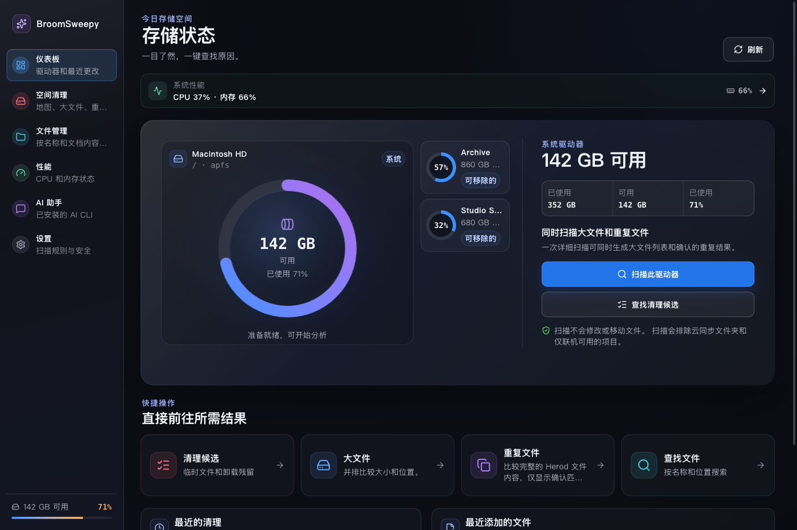
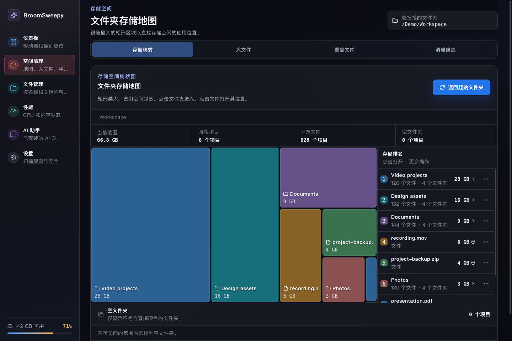
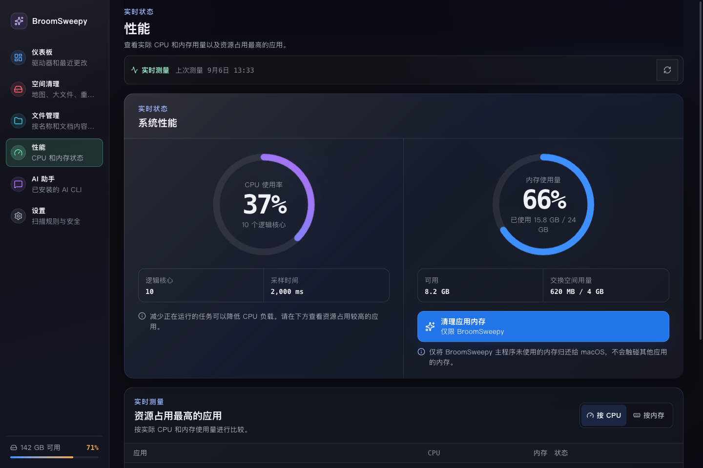
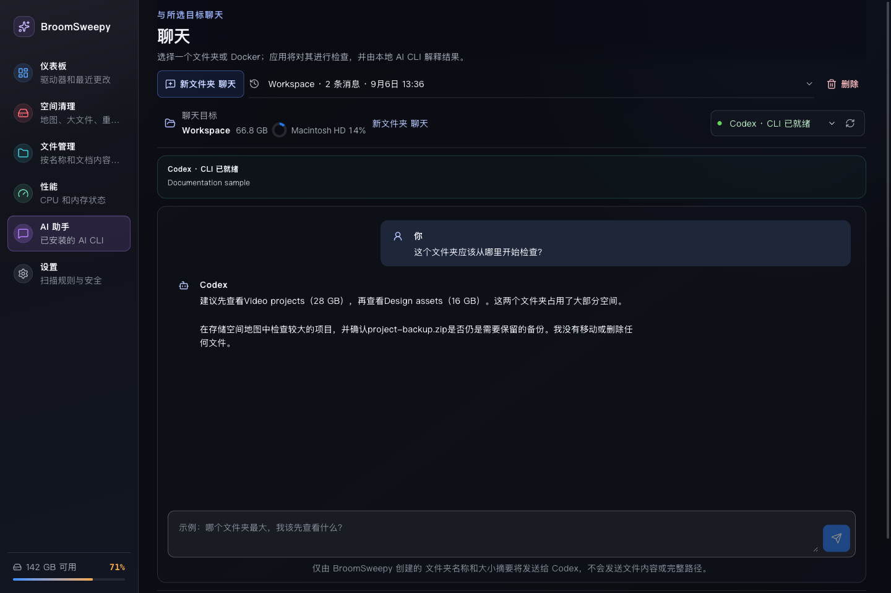
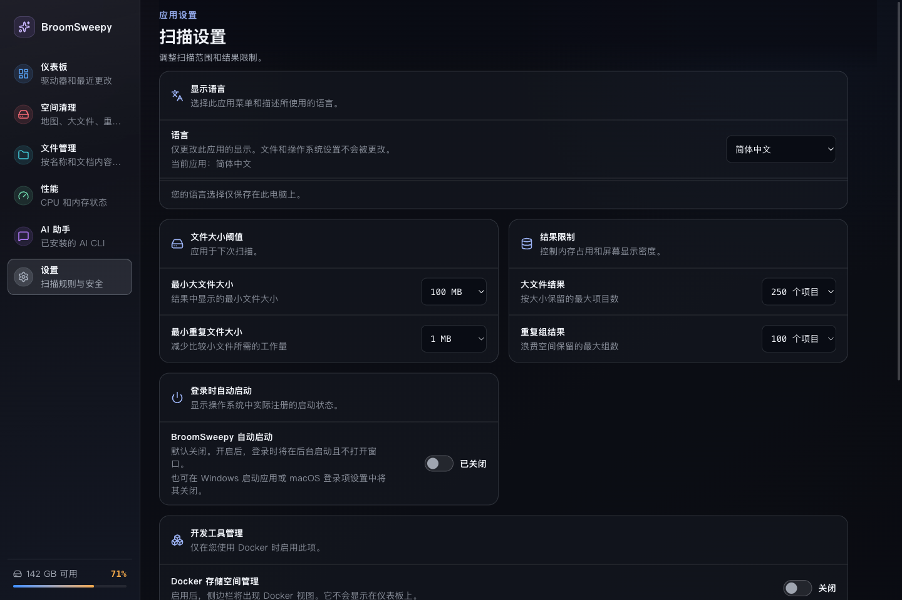

# BroomSweepy — 对话式文件管理系统

<p align="center">
  
</p>

<p align="center">
  <a href="README.en.md">English</a> |
  <a href="README.md">한국어</a> |
  <a href="README.ja.md">日本語</a> |
  <strong>简体中文</strong>
</p>

BroomSweepy 是一个面向 Windows 和 macOS 的**对话式文件管理系统**开发项目。项目以对话为主要操作方式，目标是让文件搜索、扫描、候选项审核、条件调整、最终确认和结果查看在同一工作流程中连续完成。

**当前开发和构建统一使用 Rust + Tauri 2 + React**，延续了原 SwiftUI 应用宽敞的卡片、清晰的图标和玻璃质感界面。旧版 Swift 源码和 Xcode 项目不再包含在当前工作树或构建目标中。大文件分析、经过验证的重复文件和文档搜索由本地 Rust 引擎处理；现有的浏览与扫描界面无需连接 AI 也可使用。一个安装版本支持英语、韩语、日语和简体中文，首次启动默认英语，可在 `Settings > Display language` 中更改。

## v1.8.1 — 菜单栏与语言显示修复 · 2026-10-21

- **Mac 菜单栏**：恢复顶部气泡尖角和彩色仪表。仅背景使用 `alpha 0.82`，文字和控件保持不透明，确保清晰可读。
- **显示语言**：修复应用生成的警告、依据和结果中的翻译遗漏。以 `key + params` 保存的提示会在切换语言时立即重新显示；不会改写用户文件名、路径、已有对话原文或 macOS 自身窗口的语言。
- **自动验证**：[Mac CI](https://github.com/Dannykkh/bloomsweepy/actions/runs/39556095853) 和 [Windows CI](https://github.com/Dannykkh/bloomsweepy/actions/runs/39556095857) 均通过各自的218项前端测试及Rust、构建和打包检查。已验证的DMG、EXE、MSI及校验和文件已作为v1.8.1正式/latest版本公开。
- **此Mac的安装确认**：已替换并启动CI的ARM64 DMG应用，保留3个数据库及原有英语、自动启动和内存显示设置。已检查英文警告、应用保护原因、彩色仪表、Esc、返回主窗口，以及MCP初始化版本1.8.1和12个工具。[实际安装、界面与哈希记录](docs/qa/release-1.8.1-verification.md)

直接点击状态图标、物理点击窗口外、桌面玻璃质感、旧版macOS、日语/中文实机界面、Windows GUI和长时间内存检查仍需分别验证。12项原生组件检查及用户认可的材质预览属于此前本地1.8.0的事前验证。

[v1.8.1 发布页](https://github.com/Dannykkh/bloomsweepy/releases/tag/v1.8.1) · [修复范围及发布、验证状态](docs/releases/v1.8.1.md)

## v1.8.0 — 功能与验证范围 · 2026-10-21

以下改进包含在 **v1.8.0 对应源码**中。现有 GitHub v1.7.0 安装文件保持不变，这些改进将包含在新的 v1.8.0 安装版中。正式版构建、CI 和上传仍在进行，本文不代表发布或上传已完成。

[v1.8.0 发布页](https://github.com/Dannykkh/bloomsweepy/releases/tag/v1.8.0) · [v1.8.0 发布说明](docs/releases/v1.8.0.md)

2026-10-21 的 Mac 安装与聊天验证是**显示版本为 1.7.0 的 ARM64 开发版历史记录**，不能当作新的 v1.8.0 发布二进制安装验证。

| 类别 | 已确认的范围 |
|---|---|
| v1.8.0 界面 | 按功能分组的 Mac 设置、任务导向侧边栏、六分类应用设置和全宽系统候选界面 |
| Mac/Codex 实测历史（显示 1.7.0） | 已确认大项查询、复用同一结果的容量地图、名称搜索、性能/应用/Finder 查询及授权的 1 个合成文件移入回收站。内存清理由本地确认界面执行；也确认了 Mac A 界面的构建、签名、替换及更改记录跳转 |
| 当前源码自动回归 | 192 项前端测试和类型检查通过。设置应用/恢复、错误保护及系统候选界面操作由隔离模拟测试验证；不代表 v1.8.0 发布构建、CI 或上传已成功 |
| 尚未验证 | 实际 Finder 设置写入/恢复（NOT RUN）、文档正文搜索成功路径、Windows 实机运行与安装、长时间全进程内存稳定性 |

[Mac A 界面验证历史](docs/qa/mac-design-review-2026-10-21/review.md) · [安装与 Codex 聊天验证历史及剩余体验问题](docs/qa/2026-10-21-installed-chat-audit.md) · [系统候选界面修正 QA](docs/qa/system-candidates-2026-10-21/review.md)

仍有两项已知的 P2 使用体验问题：P2-1 为返回页面后旧文件查询结果的来源标注不清；P2-2 为难以将文档正文授权范围对齐到当前对话文件夹。不绕过权限边界，也不声称所有操作都能仅靠一次聊天完成。

## v1.8.0 — 对话式文件与文件夹管理

内置聊天的回收站移动默认通过一次**是/否**确认，不再要求另开审核弹窗，也不会仅因等待时间而使确认过期。在输入框的**权限选择**或**设置 → AI 与权限 → 连接与权限 → 聊天权限**中选择`只读`、`确认后执行`（默认）或`完全访问`（`full_access`）。只读模式不准备或执行变更。显式选择完全访问后，像“删除 promo-video”这样明确列出所有目标名称的简单、直接文件/文件夹/应用本体删除请求，经重新验证后可直接处理。条件句、咨询、引用、复合句或不支持的表达仍需是/否确认。“可以删除吗？”、目标不明、相关数据、进程退出、Docker 清理和永久删除不在自动授权范围内。权限偏好遵循现有保留方式，但单项计划和批准不保存，也没有新增 MCP 或模型的执行工具。[确认流程 QA](docs/qa/2026-10-05-conversational-trash-consent.md)

完全访问模式下，打开文件夹对话后可通过**本地驱动器列表**或聊天请求查询本地卷，并将全盘名称搜索结果中的准确目标交给现有文件管理卡片。搜索有时间、项目数量和内存上限，不跟随云端、网络位置或其他挂载点。无法读取或达到限制的结果会标为部分结果，不用于自动移入回收站。此模式不授予 macOS“完全磁盘访问权限”、文档正文授权、外部 MCP 权限或永久删除权限，也不会把旧的跳过确认设置自动迁移为完全访问。[权限模式验证](docs/qa/2026-10-11-chat-access.md)

**清理候选 → 文件夹树**可展开子文件夹，进行全选或单项选择。选择父项会包含其子项；取消某个子项后，不会移动父文件夹本身。可从容量地图或AI的已测量列表打开同一扫描结果，最终确认后移入回收站。此新页面会严格检查隐藏的受保护项目、链接、云目录及设备边界。状态最多2,048个节点，界面最多200行，并明确显示未测量、部分结果和过期状态。2026-10-05 显示版本为 1.7.0 的 Mac 开发版已验证3个临时目标共209B移入回收站、子文件保留、取消、重新扫描、AI本地卡片入口及重启后的历史记录。Windows、外部模型调查全流程及长时间内存测试仍未完成。[文件夹树验证记录](docs/qa/2026-10-05-cleanup-tree.md) · [Mac实机验证](docs/qa/2026-10-05-cleanup-tree-native.md)

询问“这里最大的文件夹或数据是什么？可以删除吗？”会重新测量当前文件夹的直属项目并按容量排序。文件夹容量包含其下属项目，仅凭容量不能判断删除是否安全。点击**在容量地图查看相同结果**可在树状图复用同一次扫描。仅按名称找到的文件夹，在检查其内容前仍为未测量状态。部分结果、读取失败和过期快照会区分显示；仅提出这个问题不会选择删除目标或删除任何内容。

向 AI 请求扫描、按名称查找或清理 `promo-video` 等文件夹，Rust 应用会实际执行搜索、容量扫描、子文件夹浏览和回收站移动审核，也支持非空文件夹。同一对话的卡片提供打开、显示位置、调整选择、最终确认及逐项结果。模型只能请求应用操作，不能获得删除权限。

名称搜索最多保留200项，AI和界面每页24项，一次移动审核最多100项。未扫描的文件夹大小显示为未测量而非零。同名项目或不完整搜索不会自动选择目标。会显示完整路径、包含项目和逻辑大小，并在默认的是/否确认中说明文件夹及其全部子项将一起移动。聊天计划没有等待时间限制、仅可使用一次，修改选择、重新扫描或重启会使其失效。执行前重新检查变更、链接、云目录及受保护路径。不提供永久删除、任意 Shell、对话重命名、普通移动或创建文件夹。

这些新增功能包含在 v1.8.0 对应源码中，现有 GitHub v1.7.0 下载不包含。实际 Codex 扫描/非空文件夹审核请求及合成项目的 macOS 回收站移动，是显示版本为 1.7.0 的开发版验证历史。Windows 实机及长时间资源验证仍未完成。

在macOS中，真实文件夹内的`node_modules/.bin`等符号链接只移动链接本身，不遍历目标。审核卡片显示单独的链接数量，执行前检测目标变化。仍保护所选项/父路径中的链接、云目录、跨设备边界和特殊项；Windows重解析点/目录联接仍被拒绝。[开发版验证记录](docs/qa/2026-10-04-conversational-files.md)

### 任务导向菜单与应用设置

菜单分为**计算机**（仪表板 → 性能 → 应用管理 → 对应系统的 Mac 设置/Windows 设置）、**文件与空间**（空间清理 → 文件查找）和**工具**（AI 助手 → 可选 Docker 管理），设置位于底部。不显示其他操作系统的设置菜单；进入子页面后仍以其上级菜单标示当前位置。Docker 管理默认关闭。

**应用设置**分为常规 / 扫描与搜索 / AI 与权限 / 文件监控 / 开发者工具 / 关于六类。切换分类不会重置设置或进行中的状态。仪表板紧凑展示实际驱动器名称、容量、扫描与快捷操作，其清理候选入口直接连接系统缓存/临时文件列表。Mac 设置不再放置重复的菜单快捷卡片，优先呈现设置操作与更改记录；文件夹树仍独立保留。[菜单与设置验证](docs/qa/workspace-navigation/verify-report.md)

**系统候选**的嵌套布局已改为全宽单列，初始扫描入口只保留一个。部分结果警告在摘要、筛选和选择区域之前显示，并修正了对应系统的说明、筛选项及长路径换行。开发缓存的重新构建/下载警告、审核确认、最终确认和执行前重新验证保持不变。这是模拟界面 QA，不代表实际删除或 Windows 原生运行已验证。[修正与验证范围](docs/qa/system-candidates-2026-10-21/review.md)

### macOS — Mac 设置与开发缓存

在 macOS 的`Mac 设置`中可查询文件扩展名、隐藏文件、路径栏、状态栏和文件夹优先排序五项设置。在`文件显示`、`路径与信息`两个分组中，先用`关闭`/`开启`选择草稿值，再点击旁边的`应用`保存。仅选择不会更改设置；未设置时两侧都不选中。通过顶部`设置更改记录`可`恢复原来的设置`，包括恢复为原本没有用户设置的状态。当前值与应用先前写入的值不一致时会拒绝恢复，但这不能原子性阻止其他程序同时修改。未设置不等于关闭，确认已保存也不代表 Finder 界面已反映更改；应用不会自动重启 Finder。


这是 2026-10-21 显示版本为 1.7.0 的 ARM64 开发版实际截图，不是对比设计稿或合成设置界面，也不是 v1.8.0 发布版的安装验证截图。界面减少标题重叠与重复说明，将状态、草稿值和应用按钮并排显示。此次界面检查没有修改实际 Finder 设置值。[界面、应用/恢复模拟测试与安装验证历史](docs/qa/mac-design-review-2026-10-21/review.md)

空间清理新增 Xcode DerivedData 中至少 7 天未修改的直属项目，以及 iOS DeviceSupport 中至少 30 天未修改的直属项目。修改日期较早不代表不再使用；清理后可能需要重新构建或下载，因此只列为待审核候选，沿用选择、重新验证和移入回收站流程。项目、Archives、模拟器、Time Machine 和 AI 模型不纳入这些候选。候选项的逻辑大小不等于实际释放的磁盘空间。

聊天与外部 MCP 的 `macos.inspect` 使用同一应用引擎，仅查询设置状态。设置更改只能通过本地界面的应用/恢复按钮执行，不会因聊天启用完全访问而自动执行。不支持移除 Apple Intelligence、控制配置描述文件或后台服务。这些功能包含在 v1.8.0 对应源码中，不会替换现有 v1.7.0 安装文件。[计划与范围](docs/plan/macos-management/plan.md)

### Windows — 独立设置查询与官方设置入口

v1.8.0 对应源码在 Windows 上单独显示 **Windows 设置**，读取四项资源管理器设置和六项 AI 策略的固定注册表存储值（Recall 用户/计算机策略分别显示），并提供八个正式 Windows 设置页面入口。区分未设置、类型错误和访问被拒绝，不把存储值推断为功能实际开启或关闭。AI/MCP 的 `windows.inspect` 使用同一只读引擎。不写入注册表、不提升管理员权限、不强制移除系统包，也不更改 Defender。Mac 实测读取、回归检查及 Windows 适配器交叉类型检查已通过，但**实际 Windows 运行、安装及设置页面显示仍未验证**。现有 v1.7.0 安装文件保持不变。[实现范围](docs/plan/windows-management/implementation-contract.md) · [验证记录](docs/qa/windows-management/verify-report.md)

## v1.7.0 — 对话式工具与资源保护

以下功能范围及未验证项描述的是公开v1.7.0当时的状态。当前开发版的新增功能及验证见上文。

[正式发布与下载](https://github.com/Dannykkh/bloomsweepy/releases/tag/v1.7.0) · [更新日志](CHANGELOG.md)

- **对话式空文件夹清理**：连接本地重新扫描、候选卡片、对话排除、最终确认和逐项结果。
- **文件夹操作与打开文件**：从空间地图单独审核整个文件夹的回收站移动，区分“打开”与“显示位置”。
- **应用管理**：按名称、发布者和路径进行包含词搜索。Mac 的应用本体和相关数据分别审核；Windows 打开系统卸载页面。
- **清空系统回收站**：针对当前用户整个回收站的永久删除，需要单独确认，AI 无权调用。
- **资源保护**：有上限的流式遍历、索引内存与磁盘预算，以及独立文档处理进程。
- **macOS 菜单栏**：原生面板每10秒显示 RAM、CPU 和系统磁盘。保存内存数字显示设置；关闭窗口会隐藏，打开会恢复，退出/⌘Q 会完全结束应用。不创建额外 WebView。

菜单顺序为 **仪表板 → 性能 → 应用管理 → 空间清理 → 文件管理 → AI 助手 → 设置**。Docker 管理默认关闭。

### 对话式空文件夹清理流程

1. 在 AI 助手中选择本地文件夹，请求扫描空文件夹。
2. 审核重新扫描后的候选卡片，通过对话或复选框排除要保留的文件夹。
3. 核对准确路径和选择，点击**最终确认按钮**移入回收站。
4. 查看逐项成功、失败和跳过结果。

最多审核200项，每页向 AI 提供最多24项，并显示保护规则、变更或上限导致的遗漏数量。计划仅可使用一次，有效期五分钟，修改选择、重新扫描或重启会使其失效。聊天消息或 AI 回复本身不能授权执行。暂不支持通过对话移动普通文件或重命名。**新工具流程与实际 Codex CLI 的端到端验证仍未完成。**

### 应用管理与打开文件

`应用管理`无需扫描整个驱动器即可查看列表。Mac 优先使用应用的专用卸载程序，普通应用本体须单独确认后移入回收站。相关数据仅限通过准确应用标识符匹配的缓存和偏好设置，另行选择和审核。文档、Application Support、Containers 和共享数据不纳入自动候选项。Windows 打开系统正式的“已安装的应用”卸载页面，不推测删除应用文件夹、注册表或 AppData。打开页面不代表卸载完成。

“打开”会使用默认应用打开普通文档或媒体，使用文件管理器打开普通文件夹。可执行文件、脚本和应用包仅显示位置，不会执行。显示位置与应用内的子文件夹浏览是不同操作。这些功能不会扩大 AI、CLI 或 MCP 的删除权限。

### 本地处理、令牌与传输范围

文件搜索、扫描、汇总和候选项管理在本机完成，仅向 AI 提供有限摘要。本地文件操作本身不消耗 LLM 令牌。潜在节省来自发送必要摘要而非完整文件列表，并不是 Rust 语言本身的优势。设计良好的普通 CLI 也可能达到类似效率；尚未测量完成相同任务时的令牌节省比例。

云端 AI 会收到名称、大小、数量、候选项编号、问题和对话历史。应用生成的文件夹摘要和新候选项页面不会自动包含文件正文或完整路径，但用户输入的路径或内容可能进入问题和历史。本地 CLI 或只读权限不等于完全离线，也不保证阻止所有外部传输。另行授权的 MCP 文件和文档搜索可能返回路径与匹配片段，因此不承诺零数据传输或固定的令牌节省比例。

### 资源边界与验证限制

主进程内存超过512 MiB或系统可用 RAM 低于256 MiB时，协作式中断重任务。PDF、Office 工作进程采用128 MiB Rust 分配预算和15秒限制；索引失败保留上次完成的索引。这不是整个应用、WebView、CLI 的操作系统硬配额，也不保证解决内存泄漏。隐藏窗口仍保留原有状态与内存。

- 本地自动检查：273项 Rust 与43项前端测试通过，跳过1项可选实际 CLI 诊断。
- 尚未验证：新 Codex 工具流程、长时间全进程内存稳定性、实际用户应用删除和真正清空回收站。
- 已检查菜单栏设置保存、重启和完全退出。图标直接点击、面板内部按钮和键盘操作的视觉验证仍待完成。
- 暂不提供应用总容量、安装日期及名称/日期/容量排序选择；支持包含词搜索。
- Windows 安装程序与自动检查在 CI 中完成。CI 通过不代表实际安装、GUI 和回收站操作已验证。

## 历史公开版本界面 · v1.6.0

以下是 v1.6.0 时期实际 React 组件与公开演示数据的参考截图，不包含 v1.7.0 的导航、应用管理、新确认流程和原生菜单栏。驱动器、文件、数值和对话均为示例，并非真实 AI 回复或用户文件。浏览器截图不包含 macOS 原生窗口材质效果。

### 多驱动器仪表板



### 存储空间树状图



### CPU 与内存



### AI 助手



### 设置与显示语言



## v1.6.0 主要更新

- 深色玻璃质感界面、大尺寸操作按钮、清晰图标和简化的导航。
- 当前驱动器显示为大卡片，其他驱动器显示为小卡片；点击后以动画交换位置并缩放。
- CPU 与内存环形图、主要应用用量、采样间平滑过渡，以及减少动态效果支持。
- macOS 应用内存清理仅将 BroomSweepy 主进程中未使用的 allocator 页面归还给系统，归还 0 字节也是正常完成。
- 树状图导航与单文件操作、文件身份及路径重新验证、回收站操作日志。
- 区分 AI CLI 未安装、无法执行、版本不兼容和需要登录的状态，改进对话、取消和历史记录处理。

## 安全与云端排除

扫描不会修改文件。大文件及重复检查、驱动器汇总、树状图、文件目录和文档索引会排除已知云同步根目录与仅在线项目。macOS 的 `~/Library/CloudStorage`、`~/Library/Mobile Documents` 以及可识别的 Google Drive、iCloud、OneDrive、Dropbox 路径在遍历前就会被排除，直接选择也不会扫描。已下载但位于识别出的云目录内的文件同样排除。无法保证识别任意迁移位置的同步文件夹或所有提供商。

重复文件依次通过大小、部分及完整 BLAKE3、最终字节比较验证。文件移动须经选择、重新验证、最终确认和日志记录后进入系统回收站。v1.7.0 的空文件夹移动需要最终确认。下述清空回收站是需要单独确认的永久删除例外。移入回收站的逻辑大小不等于新增可用空间。不提供自动删除注册表的操作。

v1.7.0 在存储界面顶部新增了“打开回收站”和“清空系统回收站”。后者请求操作系统清空当前用户在已连接驱动器上的整个回收站，包括其他应用丢弃的项目，而非仅所选文件夹。必须经过单独警告、确认复选框和有效期为 2 分钟的一次性确认。不向 AI/CLI/MCP 开放，不预先扫描整个回收站，也不保证释放的空间大小。已在本地 Mac 安装版本中验证警告对话框和取消操作，但未实际清空回收站。

内存清理不会清理系统整体 RAM、其他应用、WebView 辅助进程、交换空间或内存泄漏，也没有 CPU 清理功能。macOS 正常退出应用的请求是独立确认操作，不会回退到强制结束。Windows 性能功能为只读，交换空间为基于提交量的估算值，而非页面文件当前用量。

Docker 管理默认关闭。启用后也仅使用固定命令，排除卷，并单独确认操作不可恢复。

## AI、CLI 与 MCP

v1.8.0 对应源码中，LLM 选择发起性能、已安装应用、搜索、扫描和清理候选查询，分析应用返回的实际列表后再请求必要的补充查询。内置聊天将 CLI 的结构化请求（JSON）交给应用的通用 dispatcher，并不经过外部 MCP 通信链路；外部 MCP 则使用相同的[通用能力契约](docs/architecture/app-capability-contract.md)和应用引擎。变更遵循权限模式、目标重新验证及各操作的确认规则。显示版本为 1.7.0 的 Mac 开发版已分别通过实际 Codex 流程和安装版 sidecar 的只读 stdio 检查，但这不代表 v1.8.0 发布版或所有功能、所有提供商的端到端验证已完成。[实际验证与限制](docs/qa/2026-10-21-installed-chat-audit.md)

安装 Codex 桌面应用并不代表已经安装 Codex CLI。请在应用中检查所用提供商 CLI 的安装、兼容版本和登录状态。Mac 开发版的实测历史范围见上方状态表。虽然也有 Claude Code、Grok、Antigravity、Ollama 适配器，但并未逐一完成实际运行验证。公开 v1.7.0 当时的未验证项保留在其历史发布章节中。

应用聊天会向所选提供商发送包含项目名称和大小的有限文件夹摘要、问题与对话历史。本地 CLI 不意味着模型处理离线进行。MCP 清理工具仅提供匿名候选 ID 和有限摘要，不提供批准或执行删除的工具。另行允许文件或文档搜索后，路径和匹配上下文可能传给外部客户端。最终文件操作仍由应用内的权限与确认规则控制。

## 平台与开发

需要 Rust stable、Node.js 22+ 和 npm。Windows 还需 WebView2 与 MSVC Build Tools，macOS 还需 Xcode Command Line Tools。

- `apps/desktop/`：主 Tauri/React 应用
- `crates/bloomsweepy-core/`：共享 Rust 分析引擎
- `crates/bloomsweepy-control/`、`apps/bloomsweepy-mcp/`：本地控制协议与 CLI/MCP 桥接

旧版 Swift 源码可从[保留的 v1.8.1 标签](https://github.com/Dannykkh/bloomsweepy/tree/v1.8.1/BroomSweepy)查看或恢复，不再位于当前工作树中。

Apple Silicon Mac 本地开发构建的部分实测属于显示版本为 1.7.0 的验证历史，不能替代 v1.8.0 发布二进制的验证。当前源码自动回归范围及待验证项见上文。Windows 安装程序由 CI 构建，但不代表原生实机验证或本次 CI 已成功。此前的 Mac 验证构建采用 ad-hoc 签名，并非已经 Apple 公证。v1.8.0 构建、上传状态及平台注意事项请查看[发布页](https://github.com/Dannykkh/bloomsweepy/releases/tag/v1.8.0)。

```sh
cd apps/desktop
npm ci
npm run tauri dev
```

```sh
# Repository root
cargo fmt --all -- --check
cargo clippy --workspace --all-targets -- -D warnings
cargo test --workspace
cd apps/desktop
npm run check
npm run test:all
npm run build
npm run tauri build
```

## 文档

[更新日志](CHANGELOG.md) · [CLI 连接与控制](docs/cli-control.md) · [性能与内存边界](docs/architecture/startup-memory-status.md) · [安全回收站操作](docs/architecture/safe-trash-actions.md) · [文档搜索](docs/architecture/document-search.md) · [文件搜索](docs/architecture/fast-file-search.md) · [设计](DESIGN.md) · [复现截图](docs/assets/screenshots/README.md)

## 重要提示：数据丢失与恢复责任

BroomSweepy 设计为只处理用户选择并最终确认的项目。但是，是否能够恢复仍可能受到操作系统权限、回收站设置、同步服务，以及外置或网络驱动器状态的影响。Docker 清理不使用操作系统回收站，已完成的步骤无法恢复。

执行清理前，请备份重要数据，并核对所有选定路径、文件和 Docker 分类。除法律规定不得排除的责任外，项目提供者和贡献者不对用户发起的文件移动、删除、清空回收站或 Docker 清理造成的数据丢失或恢复失败承担责任。
