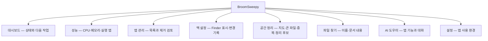
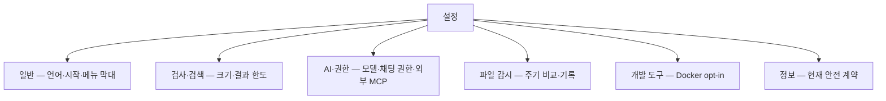

# Workspace navigation

전역 순서는 기존 사용자 요청의 대시보드→성능→앱 관리 순서를 보존한다. Mac 설정은 macOS에서만 표시하며 Windows 지원 기능이 있는 것처럼 빈 메뉴를 만들지 않는다. route ID는 바꾸지 않고 UI 이름을 실제 범위로 좁힌다.

Docker는 기존 opt-in 이후 AI 뒤에만 추가한다. 위계 표시는 컴퓨터/파일과 공간/도구의 세 그룹, 설정은 하단 유틸리티다. 메뉴/탭은 현재 route의 부모를 aria-current로 알린다.

설정 분류는 기존 패널을 한 번씩만 마운트하고 hidden으로 교체해 실행 상태·입력·고정 ID를 보존한다. 새 일괄 저장 버튼은 만들지 않는다. Mac/대시보드의 캐시 정리는 openSystemCleanup composition에서 system 모드로 이동할 뿐 검사하지 않는다. 일반 cleanup navigation은 tree 모드를 덮어쓰지 않는다.
