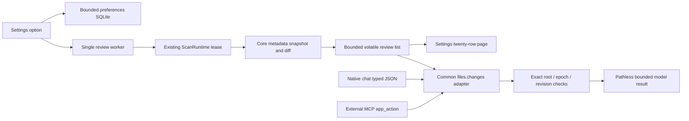

# File review routine — in progress

- Time: 2026-10-08 11:25 Asia/Seoul
- Project: BroomSweepy
- Branch: main (HEAD f1feac19)
- Origin: 사용자가 변경 파일을 감지하고 검토·넘김 처리하는 루틴을 옵션으로 요청함. 현재 사용자 턴, 세션 UUID 미제공.
- State: 컨텍스트 압축 연속성 기록. 최초11:25 이후 같은 기록을11:57에 갱신; 소스 구현/테스트 완료, 설치 앱 미교체.

## Scope and decisions

기본 OFF, 사용자가 선택한 폴더 하나, metadata-only 주기 비교(5/15/30분).
실시간 watcher/백신/랜섬웨어 방어라고 표현하지 않는다. 첫 완전 목록은 baseline.
변경·삭제·새 항목을 분류하고 검토 필요/선택 규칙 불일치 넘김을 표시하되 안전 판정 아님.
AI 자동 호출, 내용 전송, 자동 삭제/격리/파일 실행은 범위 밖.
불완전 스캔을 baseline 또는 삭제 근거로 commit하지 않는다.

## Evidence and reuse

- `crates/bloomsweepy-core/src/streaming_walk.rs`: bounded metadata DFS, cloud/placeholder/reparse 제외, 링크 비추적.
- `crates/bloomsweepy-core/src/local_search.rs`: ancestor link 검사 및 canonical root 검증.
- `apps/desktop/src-tauri/src/lib.rs`: ScanRuntime의 단일 작업 lease/취소, 종료 결합.
- 기존 최근 파일은 수동 catalog 갱신의 신규 관측 결과이며 live watcher 아님.
- 관련 기억: architecture 009/010/013. 외부 공개 권한을 루틴 ON과 혼합하지 않는다.

## Current State Summary

선택적 변경 검토 core/runtime/UI와 read-only files.changes 연결 완료. 최신 Rust/MCP422·frontend119 통과.
core98/desktop280/control29/MCP15, 기존 desktop opt-in4 ignored. typecheck/build/fmt/diff/contract 통과.
실제 임시 파일 변화와 단일 worker12회 ON/OFF 세대 취소 테스트, 합성 UI 넘김/재변경/페이지/1280·390px 관찰.

## Origin

사용자 현재 요청: 감지한 파일을 검토하고 넘길 것은 넘기는 루틴을 옵션으로 추가.
현재 인간 사용자 턴의 원본 시각/세션 UUID는 미제공; 도구 turn-id를 세션 ID로 사용하지 않는다.
발췌 근거: conversations/2026-10-08-file-change-review.md, 11:57 KST 기록.

## Feature/Flow/Decision Snapshot

설정 ON/루트/주기 → 전용 설정 SQLite → 단일 scheduler → ScanRuntime lease → core metadata snapshot/diff
→ 비영속250개/1MiB 기록 →20행 Settings 목록. 첫 완전 검사만 기준, 불완전 결과는 반영 안 함.
새 변경은 이전 수동 넘김을 재사용하지 않으며 범위 변경·OFF·종료는 취소/revision으로 늦은 결과를 거부.
동일 루트의 native chat/MCP는 기존 목록만 조회하고 모델에 full paths/internal IDs/local errors를 보내지 않는다.

## Composition Diagram

## Implemented Features

| Feature | Ownership / files |
|---|---|
| Baseline/diff·local scope guards | crates/bloomsweepy-core/src/file_change_review.rs, streaming_walk.rs, lib.rs |
| Optional scheduler/settings/history | apps/desktop/src-tauri/src/file_change_review.rs, lib.rs |
| Shared read-only AI/MCP capability | crates/bloomsweepy-control/src/capabilities.rs, lib.rs; desktop app_tools.rs/app_tools_file_changes.rs |
| Settings review and chat result | FileChangeReviewPanel.tsx/.css, fileChangeReview.ts, SettingsView.tsx, AssistantAppToolCard.tsx, i18n 3 catalogs |
| Synthetic test surface | file-review-fixture.html, src/file-review-fixture.tsx, tests/fileChangeReview.test.ts |

## Important Context

설치 앱은 기존 개발1.7.0이다. 이번 소스를 설치·릴리스·커밋·푸시하지 않았다.
개인 폴더·cloud 자료 검사/삭제/내용 전송 없음. 새 자동 OS 알림이나 예약 정리 기능은 범위 밖.
APFS invalid UTF8 파일 생성 테스트 실패는 native path validation과 Linux-only FS fixture로 분리 후 통과했다.
폴더는 합산하지 않아 용량 미측정/null이다. truncation은 최신 일부도 생략할 수 있으므로 전체 목록 아님.
최근 스냅샷과 검토 기록은 앱 재시작 시 초기화하고 설정만 유지한다.
code map은 기존 자동 snapshot으로 새 파일 미반영; 생성기/API를 확인하지 못해 수동 편집하지 않았다.

## Immediate Next Steps

1. 사용자가 설치 교체를 요청하면 새 native 빌드/설치에서 임시 폴더만 선택해 IPC·주기·OFF·재시작 확인.
2. 신규 files.changes 실제 Codex/MCP 대화 종단과 Windows 설치/원격 볼륨 검증.
3. 장시간 soak/OS I/O 종료 제한은 아직 미확인. 필요하면 상한과 누락 상태를 실측.
4. 검토·범위 밖 추가 권한을 받기 전 자동 AI·내용 검사·예약 삭제·격리로 확대하지 않음.

## Decisions Made

architecture014에 이번 옵션과 공개 권한·상한·비영속 수명을 기록했다. 기존009/010/013을 뒤집지 않고 확장했다.
README/기능 계약/DESIGN/experience/layout/direction/critique/implementation/QA 정본 연결을 갱신했다.

## Resource and verification

전 턴에서 Rust 캐시만 약3GiB 제거했고 앱/소스/node_modules 보존. 이 시점 Data volume free8.6GiB.
Rust 캐시가 없어 full compilation 필요; jobs1/incrementaloff와 디스크 상태 확인.
현재 feature tests PASS 범위는 위 Current State 및 docs/qa/2026-10-08-file-change-review.md 정본 참조.
마지막 target1.5GiB/Data free5.1GiB 관찰. 이번 컴파일 cache는 재사용 대상으로 보존, 새 QA dev server는 종료함.
설치형/Windows/실제 AI 신규 호출/장시간 soak는 NOT RUN. 브라우저 viewport override는 reset했다.

## Session Memory Review

프로젝트 실제 `.git`와 docs/memory/conversations 비링크 확인. architecture index 및009 실제 본문 확인.
닥터 방문2026-09-29, 30일 미만이고009/013 실제 본문과 링크 존재하므로 진단 재실행 안 함.
architecture014/index와 현재 발췌 대화에 검증된 결정 반영, 별도 gotcha/learned는 세션 UUID 부재로 기존 백로그와 혼합하지 않음.
MEMORY.md는 기존 architecture/index 연결을 유지하여100줄/5KB 상한을 늘리지 않음. 프로젝트 로컬 스킬 개선 후보 없음.
014를 인덱스에서 재검색했고 check_memory_anchors의 실제 코드 앵커6개 존재 검증 통과.
validate_handoff는 필수 섹션/Origin/Composition/민감값 검사 통과, READY. 자동 생성 코드맵 이동 후보는 unavailable로 보고됨.
생성/검증 도구와 실제 실행 범위를 구분한다.

#tags: file-review, optional-monitor, bounded-metadata, verified-source, installed-not-updated, arch:014
