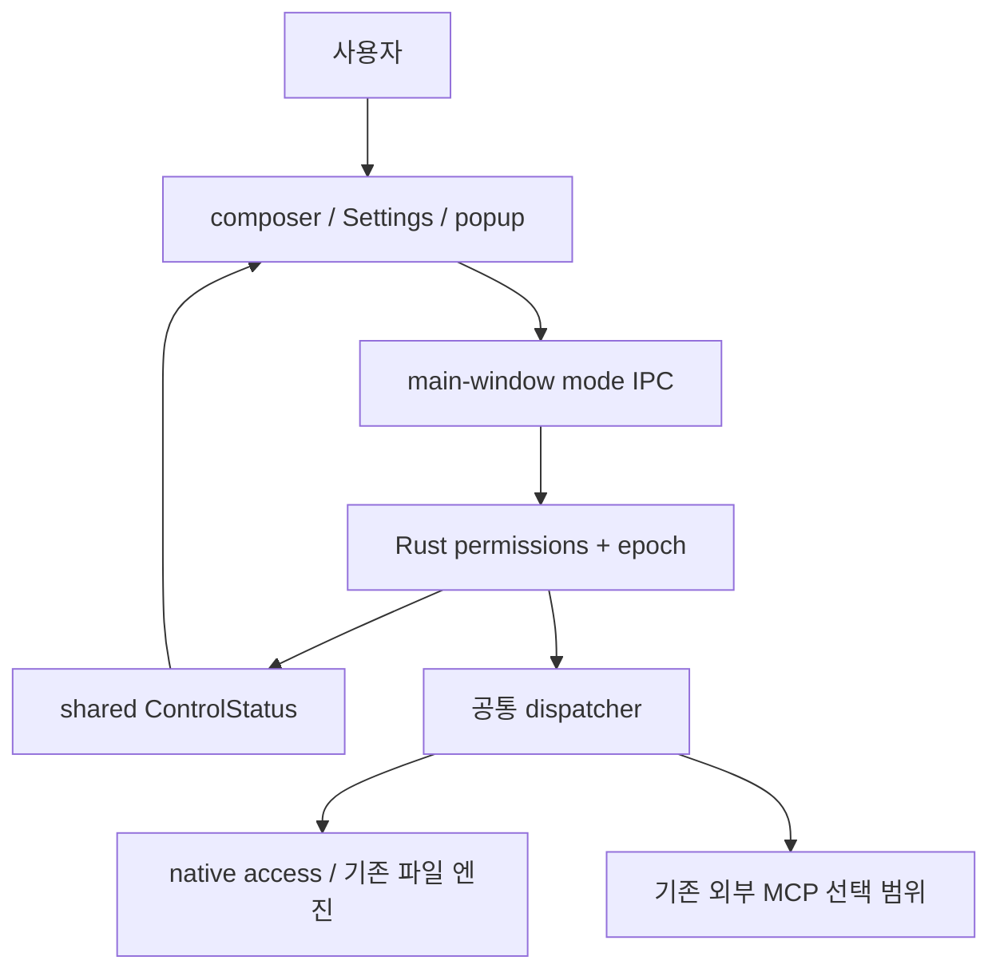
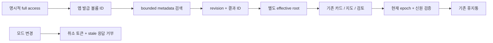

# Handoff: 내장 채팅 권한과 유한 로컬 접근

## Session Metadata

- Created: 2026-10-11 10:49:59 KST
- Project: BroomSweepy
- Branch: main / HEAD f1feac1
- Trigger: 컨텍스트 압축 이후 연속성 기록. 새 chat/branch 생성 아님.
- Duration: 원본 세션 시작 미제공. 이번 개발·검증 범위만 기록한다.

## Origin

사용자의 “채팅에서 전체 사용 엑세스같은 기능도 있어야겠는데?” → “진행” → “ㄱㅖ속”을
이어 구현한다. 입력창에서 현재 정책을 알 수 없고 선택 폴더 밖 로컬 검색을 할 수 없던 문제를
해결한다. 원본 턴 시각·세션 UUID는 미제공으로 추정하지 않았다.
근거: [요구/결정](../../conversations/2026-10-11-chat-access.md),
[Experience Contract](../design-refs/2026-10-11-experience-chat-access.md).

## Current State Summary

composer·Settings·연결 popup의3모드, Rust authority/epoch, bounded native 볼륨/이름 검색,
기존 파일 카드·용량지도 연결을 구현했다. frontend126·타입·production build·합성 UI는
통과했다. Rust desktop286 PASS/4 opt-in ignored、core108/control29 PASS、최후 ID 보강 focused2 PASS.
최종 범위는 [QA](../qa/2026-10-11-chat-access.md)에 기록했다. 설치본 교체·실제 CLI·Windows는 NOT RUN.
기존 Oct8 dirty 변경이 포함된 worktree 전체를 이번 작업으로 오인하지 않는다.

## Session Memory Review

- Architecture preflight: SKIPPED —009/010/011 본문 확인; 마지막 닥터 방문2026-09-29,12일 전으로30일 미도래.
- Anchor index: RAN — 생성기20파일,015의 files 구분자 확인 후26파일로 재생성. assistant_access→015 역조회 성공.
- Memory/index updates: memory/architecture/015-native-chat-access.md, architecture/index, MEMORY.md.
- Retrieval verification: chat-access→index015→본문·대화·QA 링크를 재검색했다.
- Observations: 결정015만 기록. 원본 세션 UUID·시작 시각이 없어 원시 gotcha/learned 정제는 보류, 기존 백로그 제외.
- Skill candidate: defer — 프로젝트 전용 개선 스킬 미확인, 전역 스킬 수정/자동 생성하지 않음.
- Component map: N/A — component-map.json 없음, 기존 codemap은 탐색 근거로 사용.

## Feature/Flow/Decision Snapshot

### Implemented Features

|Feature/Change|Visible Behavior|Entry Point|Implementation Anchors|Verification|
|---|---|---|---|---|
|권한 모드|조회만/확인 후 실행/전체 접근, ACK 후 표시|composer/Settings/popup|PermissionControl, control_server|합성 UI·타입·단위 테스트|
|전체 로컬 조회|목록→이름 검색→정확한 대상 카드|file_workspace4operation|assistant_access, local_search|소스 리뷰, 최종 Rust 결과 QA|
|권한 축소|늦은 응답/검토 거부·실행 취소 요청|native epoch+JS revision|provider/files/tools·각 실행 경계|독립 소스 리뷰; 설치형 NOT RUN|

### Feature Boundary

|Feature/Area|Does|Does Not Do|Source of Truth|
|---|---|---|---|
|모드|native main-window opt-in|모델/JSON으로 권한 변경|permission_settings/control_server|
|전체 로컬|유한 metadata·opaque ID·별도 root|cloud/network hydration·model raw path|assistant_access/local_search|
|실행|기존 Trash/journal 재검증|영구삭제·MCP 자동실행·과거 승인 복원|기존 엔진+native binding|
|공개|기존 동의와 결과 분리|문서·OS FDA·외부 grant 자동 활성화|공통 capability 계약|

### Menu / Screen Map

|Menu|Screen / View|Features on this screen|Route/Path|Status|
|---|---|---|---|---|
|대화|AssistantView|CLI·모델/추론·권한·로컬 볼륨 카드|assistant|개발본 구현|
|설정|SettingsView|수명·같은 모드·외부 MCP 분리|settings|개발본 구현|

### Composition Diagram

### Flow Diagram

### Decision Records

015는009 수명·011 직접 명령 검증을 계승하고010에 native 전체 볼륨 예외만 추가한다.
외부 선택 폴더 계약은 유지한다. old flag 자동 승격/frontend-only 권한은 제외했다.
기존 기억 전체를 SUPERSEDED로 오인하지 말고015의 설정 표현·예외를 함께 읽는다.

## Codebase Understanding

### Architecture Overview

내장은 Tauri IPC→strict JSON→공통 dispatcher, 외부는 MCP stdio→같은 dispatcher이다.
내장까지 MCP wire를 통과하지는 않는다. native4operation은 외부 Unsupported.
모델 data와 로컬 presentation을 분리하며 새 자동 결과에 전체 경로를 넣지 않는다.

### Critical Files

- apps/desktop/src-tauri/src/assistant_access.rs: effective scope·ID·계획/취소 binding.
- apps/desktop/src-tauri/src/assistant_files.rs: 기존 파일 작업·volume scan·partial guard.
- apps/desktop/src-tauri/src/control_server.rs: 저장·native epoch·권한 잠금.
- apps/desktop/src/views/AssistantView.tsx: 통합·비동기 revision·카드/범위 교체.
- crates/bloomsweepy-core/src/local_search.rs: metadata-only 유한 walker.

### Key Patterns Discovered

수동 기능은 유지하되 채팅 plan/preview는 epoch에 결속한다. 취소는 협력적 요청이며 진행 중
파일시스템 호출 강제 종료를 보장하지 않는다. partial/동명이인으로 잃은 자동실행 자격을
볼륨 열기로 초기화하지 않는다. 새롭고 충분한 검사·검토가 필요하다.

## Work Completed

### Tasks Finished

- UI/types/bridge/설정 공유·중복 checkbox 정리·4언어.
- Rust 모드 저장/기본값·direct 경계·effective root·bounded 조회.
- cleanup 취소 누락/provider 마지막 epoch 검사 누락 수정 소스 재검토.
- 실제 합성 UI·frontend126·타입/build, 정본 문서/기억.

### Files Modified

이번 범주만 열거한다. 기존 Oct8 provider/file-review 변경도 이미 dirty였다.
UI: App/AssistantView, PermissionControl, File/Empty/AppTool cards, ControlStatusPanel, types/bridge,
assistantPermissionMode/Confirmation, fixture, i18n/tests.
Rust: assistant_access, permission/control, provider/files/tools, app/memory/process/Docker/cleanup/trash
경계와 local_search/scan_policy/directory.
문서: DESIGN/README/capability/model 계약, Oct11 design refs/QA,015·인덱스·대화·본인계.

### Decisions Made

default confirm; explicit confirm은 old flag와 무관하게 항상 확인. Full은 native 로컬 조회+
기존 strict 직접 휴지통 명령 opt-in. 모델·OS·MCP·본문 공개와 분리한다.
대체 대상: none —009/010/011의 수명/외부 범위/검증을 폐기하지 않는 국소 확장015.

## Pending Work

### Immediate Next Steps

1. 구현·합성/단위 검증은 완료했다. QA의 실제 실행 범위/NOT RUN을 다음 검증의 기준으로 삼는다.
2. 사용자 요청 시 저공간을 확인하고 새 설치본 교체/재시작 모드 복원을 검증한다.
3. 실제 CLI 종단·Windows·실장치·장시간 resource는 별도 안전 fixture로 진행한다.

### Blockers/Open Questions

설치형/Windows 런타임 증거는 없다. 구현 blocker로 과장하지 않고 검증의 남은 범위로 본다.

### Deferred Items

백신/전역 실시간 감시·정기 temp 삭제·cloud 검사·영구삭제 확대·chunk 분할은 범위 밖.
Product Design은 설치했지만 session catalog 미노출로 실행 어댑터 비교 NOT RUN.

## Context for Resuming Agent

### Important Context

실제 앱 권한을 자동 켜지 않았다. 사용자 파일 삭제·앱 교체·커밋·푸시도 하지 않았다.
기존 dirty worktree와 demo-assets를 보존한다. Rust는 저공간/8GiB 때문에 반드시 단일 작업,
debug0·incremental0·jobs1. 앱은 dark-only이며 light QA를 꾸미지 않는다.

### Assumptions Made

폴더 대화를 먼저 여는 anchor를 유지한다. 전체 접근은 모든 파일을 읽는 보장이 아니라
로컬 유한 조회 opt-in이고 OS 거부·상한은 부분 결과로 설명한다.

### Potential Gotchas

실제 search payload에는 volumes와 entries가 함께 있어 accessKind로 분기해야 한다.
권한 변경 후 늦은 provider/검사/검토를 성공으로 반환하거나 카드에 복원하지 않는다.
old flag→full 자동 이관은 조회 범위까지 동의 없이 확대한다.

## Environment State

- Tools/Services: native collaborators, CUA 합성 UI, Node/Vite, 단일 Cargo, Mnemo 검증.
- Active Processes: 검증용 Vite 서버 종료, CUA 임시 탭 종료/viewport 복구. Cargo 작업 모두 완료.
- Environment variable NAMES: CARGO_BUILD_JOBS, CARGO_PROFILE_TEST_DEBUG, CARGO_PROFILE_DEV_DEBUG, CARGO_INCREMENTAL.

## Related Resources

[QA](../qa/2026-10-11-chat-access.md), [015](../../memory/architecture/015-native-chat-access.md),
[구현 로그](../design-refs/2026-10-11-impl-log-chat-access.md), [계약](../architecture/app-capability-contract.md).

#tags: handoff, chat-access, native-permission, bounded-search, arch:015
