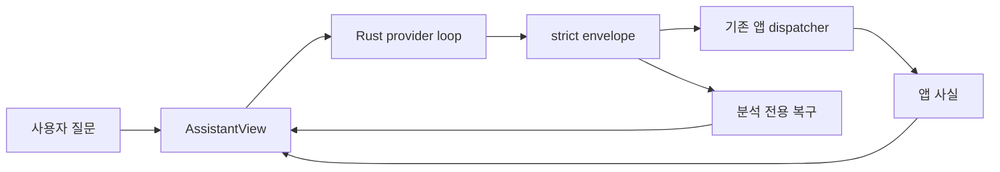
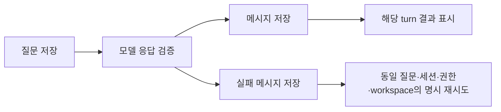

# Handoff: 채팅 응답과 결과 카드 수명 수정

## Session Metadata
- Created: 2026-10-11 15:57:31 KST
- Project: BroomSweepy
- Branch: main, base a4759b1
- Updated: 2026-10-11 16:24 KST
- Session duration: 구현·검증·설치 완료; 컨텍스트 압축에 따른 인계 최종 갱신

## Handoff Chain
- Continues from: none — 이전 설치 인계와 별개의 버그 수정
- Supersedes: none

## Origin
| 항목 | 내용 |
|---|---|
| 요구 | 앱에서 질문해도 답하지 않고 완료한 조회 카드가 맨 아래에 계속 남는 문제 수정 |
| 출처 | 현재 대화의 사용자 “진행하자”; 세션 UUID 미확인 |
| 해결할 문제 | 형식 오류로 사용자 질문만 남는 현상과 과거 결과가 최신 질문 아래에 붙는 현상 |

## Current State Summary
구현·독립 리뷰·Rust291/frontend132·별도 실제 Codex 일반 질문/schema 왕복·합성 브라우저·ARM64 빌드/설치 검증이 완료됐다. 설치 앱에서 관찰한 JSON 형식 오류와 카드 하단 잔류에 대응했다. raw 응답은 기존 정책상 삭제되므로 정확한 잘못된 출력 형태는 미확인이다. 기존43메시지·권한·모델/추론강도 복원을 확인했다. 사용자 실패 질문 재연/삭제 작업/commit/push는 하지 않았다.

## Session Memory Review
- Architecture preflight: SKIPPED — 실제 본문 존재, 마지막 닥터 방문 12일 전.
- Anchor index: RAN — provider/tools/AssistantView 확인, 008·011·013·015 본문 검토. legacy files 메타데이터의 구분자 때문에 일부 역색인 미검출을 수동 보완했다.
- Memory/index updates: 008/013와 MEMORY.md 반영. 기존 권한/승인/공통 dispatcher 계약 유지.
- Retrieval verification: MEMORY.md → 008-conversation-workbench, 011-conversational-trash-consent, 013-common-file-mcp-results, 015-native-chat-access 확인.
- Observations: 세션 UUID/시작 시각 미확인이므로 원시 관찰 백로그 정제와 offset 이동은 하지 않음.
- Skill improvement: candidate none — 프로젝트 전용 스킬 대상이 없고 제품 코드 수정 과제다.

## Feature/Flow/Decision Snapshot
### Implemented Features
| Feature/Change | Visible Behavior | Entry Point | Implementation Anchors | Verification |
|---|---|---|---|---|
| 응답 형식 복구 | 완전 JSON fence 정규화, 실패 시 분석 전용 1회 복구 | ask_assistant | assistant_provider.rs, assistant_tools.rs | Rust291 PASS, 실제 Codex 추가1 PASS |
| turn별 결과 | 해당 답변에 연결되어 함께 스크롤 | AI 도우미 | AssistantView.tsx, assistantTimeline.ts | frontend132, 브라우저 PASS |
| 실패 표시/재시도 | 질문 위치의 오류와 범위에 결속된 명시적 재시도 | AI 도우미 | AssistantView.tsx | retry/취소/수동 검사 브라우저 PASS |

### Feature Boundary
| Feature/Area | Does | Does Not Do | Source of Truth |
|---|---|---|---|
| 복구 | 총 5 모델 호출/4 action/600초 안의 분석 전용 복구 | 잘못된 action 실행, raw 로그, 실행 action 재연 | assistant_provider.rs |
| 카드 | 제한된 evidence와 live 권한 분리 | 과거 실행권한 재활성, 전체 payload DB 저장 | AssistantView.tsx |

### Menu / Screen Map
| Menu | Screen / View | Features on this screen | Route/Path | Status |
|---|---|---|---|---|
| AI 도우미 | 대화 | bottom composer, 실제 진행, turn별 evidence | AssistantView | source/fixture/installed smoke verified |

### Composition Diagram

### Flow Diagram

### Decision Records
| Decision | Options Considered | Rationale | Record/Follow-up |
|---|---|---|---|
| 기존 object wire 유지 | action JSON 문자열 스키마 제외 | typed 계약 복제 방지 | Codex 분석 전용 schema만 선택 적용 |
| raw 재전송 금지 | malformed 원문 repair 제외 | 민감 내용과 도구 지시 반복 방지 | 원래 질문·실제 evidence 사용 |
| 기존 디자인 유지 | 전체 재디자인 제외 | 버그 수정 범위 | DESIGN.md Agent Workbench |

## Work Completed
- 실제 앱 오류와 카드 위치 구조 확인.
- backend/UI 독립 파일 소유권 위임.
- 사용자 대화/권한 DB 내용 변경하지 않음. 설치본만 백업 후 수정한 ARM64 빌드로 교체.
- backend/UI 구현·독립 정적 리뷰 완료. workspace 변경 후 retry 재사용 finding 수정.
- Rust291 PASS/5 ignored, 별도 실제 Codex 일반 질문/null-action schema1 PASS, frontend132 PASS.
- TypeScript/locale/build/fmt/diff PASS. 브라우저 오류·retry 중복 없음·카드 turn 귀속·과거 검토 비실행·아니오 완료·지연 취소·1280/390px 입력창 확인.
- README/DESIGN/정본 계약/경험 설계/QA/008·013 기억 갱신. 합성 캡처2개만 저장.
- ARM64 Tauri app build PASS. 최초 resource seal 실패 후 기존 ad-hoc/entitlements로 sidecar→worker→app 재서명, strict 검증 PASS.
- 설치 main SHA6311753af76b4d54142a5551f62c81c64ef086bf1ab7d1f85935afc05a44e48b, 대화/권한 DB hash 동일, 설치 UI43메시지/Codex 준비/모델·권한 복원 PASS.

### Files Modified
| File | Changes | Rationale |
|---|---|---|
| apps/desktop/src-tauri/src/assistant_provider.rs | prompt/복구/schema/회귀/실 CLI 진단 | 답변 누락과 잘못된 실행 차단 |
| apps/desktop/src-tauri/src/assistant_tools.rs | fence 정규화/required action/취소 guard | strict protocol 유지 |
| apps/desktop/src/views/AssistantView.tsx | turn별 결과/오류/완료 실제 결과 보존 | 카드 위치와 재시도 수정 |
| apps/desktop/src/lib/assistantTimeline.ts | helper+tests |160턴/상세16/live16 상한·권한/workspace 결속 |
| apps/desktop/src/assistant-tools-fixture.tsx | 합성 retry/error/delay 사례 | 실제 파일 작업 없는 UI 검증 |
| apps/desktop/src/i18n/index.tsx,ja.json,zh-CN.json | 새 오류/재시도/역사적 근거4문구 번역 | ko/en/ja/zh-CN |
| DESIGN.md,README.md,docs/architecture/app-capability-contract.md,docs/design-refs/2026-10-05-experience-chat-workbench.md | 정본 반영 | 새 동작·경계·상한 |
| docs/qa/2026-10-11-chat-response-timeline.md | 실제 검증과 NOT RUN | 합성/실 CLI/설치 구분 |
| MEMORY.md,memory/architecture/008-conversation-workbench.md,memory/architecture/013-common-file-mcp-results.md | 기존 결정 보완 | 검색 가능한 근거/대안 |
| conversations/2026-10-11-codex.md | 기존 자동 기록 유지 | 사용자 변경 보존 |

### Decisions Made
대체 대상 none — 기존 008·011·013·015를 뒤집지 않는 보완이다.

## Pending Work
### Immediate Next Steps
요청 범위의 필수 작업은 완료했다. 사용자가 기존 실패 질문을 다시 보내 실제 사용 흐름을 확인할 수 있다. 실제 사용자 질문 자동 재실행은 하지 않는다. commit/push/release는 별도 요청이 있어야 진행한다.

### Blockers/Open Questions
- malformed raw 형태 기록 없음. 추정 확정 금지.
- 실제 사용자 대화/삭제 대상에 테스트 질문이나 삭제 재연 금지.

### Deferred Items
- 문서 검색 filter 경합은 별도 진단으로 현재 범위 밖.
- Windows 실기기 검증은 이 Mac에서 불가능.

## Context for Resuming Agent
### Important Context
- root/backend/UI/readonly review 모두 구현/정적 검토 반환 완료. 작업자 최종 frontend132 재검증 완료.
- worker Cargo 금지, root만 실행. compiler cache 약 2.9GiB 삭제 후 cold build. 가용 공간 약16GiB.
- dirty demo-assets/ 기존 실제 화면19MiB, 추적/삭제 금지.
- 설치 /Applications/BroomSweepy.app v1.7.0 PID52626, 수정 빌드로 실행 중. 사용자 전체 접근 권한 변경 금지. 이전 bundle은 /private/tmp/broomsweepy-chat-response-install-OCEqkm/Previous-BroomSweepy.app 및 Replaced-BroomSweepy.app에 보존.
- 외부 MCP/다른 Codex 프로세스 종료 금지.
- action object 유지. 복구 action:null만 허용, 증거 없는 완료 주장 금지.

### Potential Gotchas
- 과거 카드 authority와 현재 mutable workspace 혼합 금지.
- retry session/permission/workspace revision/cancel guard와 질문 중복 저장 금지. 수동 검사·검색·볼륨 탐색 시 무효화 필수.
- 새 질문은 이전 삭제 승인/취소가 아님.

## Environment State
- macOS Apple Silicon8GiB; danger-full-access, approval never.
- node_modules 보존. root 소유 Vite session72664/PID46774는 검증 후 종료했다. 사용자 앱/외부 MCP는 유지한다.
- 인증 파일 열람 없음. 원시 provider 응답 영구 저장 없음.

## Related Resources
- DESIGN.md
- docs/design-refs/2026-10-05-experience-chat-workbench.md
- memory/architecture/013-common-file-mcp-results.md
- memory/architecture/015-native-chat-access.md

#tags: chat-response, evidence-timeline, format-recovery, 중간인계, arch:008, arch:011, arch:013, arch:015
