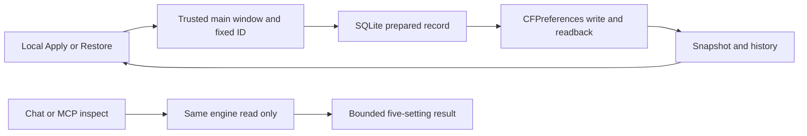

# Handoff — macOS management validation

- 시각: 2026-10-20 20:47:48 KST, 작성 Codex.
- 프로젝트: `/Users/dannysmacair/Documents/git/BroomSweepy`, branch `main`, HEAD `85620ca41ae0c5be82b5a9a36672186fa77640b9`.
- Origin: 사용자 “제우스 계획을 세우고 프로그램 개선까지 진행하자”. 근거: 현재 사용자 요청과 [기록](../../conversations/2026-10-20-team-poseidon.md#사용자-요청). 세션 UUID/원래 턴 시각 미제공.
- 압축 중 연속성 보존용 자동 인계. 원래 작업은 계속 진행하며 이 문서 작성은 완료 판정이 아니다.

## Origin

현재 사용자 요청의 제우스 계획·프로그램 개선을 끝까지 실행하는 것이 목적이다. 범위와 원문 근거는 위 메타데이터와 현재 대화에 있으며 이전 인계로부터 요구를 추측하지 않았다.

## Current State Summary

제우스 첫 개선 단계: Finder Bool5개 조회·로컬 적용·내구성 복원, 개발 캐시 Review 후보, 맥 관리 화면, 공통 read-only `macos.inspect`까지 구현했다. [계획](../plan/macos-management/plan.md), [API](../plan/macos-management/api-spec.md), [스키마](../plan/macos-management/db-schema.md), [흐름](../plan/macos-management/flow-diagrams/index.md)이 정본이다.

## Feature/Flow/Decision Snapshot

### Implemented Features

| Feature | Boundary | Evidence |
|---|---|---|
| Finder 설정 | 고정 Bool5개/로컬 적용·복원 | mac_settings.rs, MacManagementView |
| 개발 캐시 후보 | 고정2경로/수정일7·30일/Review | mac_cleanup.rs, core cleanup.rs |
| AI 조회 | read-only macos.inspect/공통 엔진 | capabilities.rs, app_tools.rs |

### Composition Diagram

### Feature Boundary / Flow Diagram

입력→고정 ID/출처/현재값 검증→SQLite FULL prepared 커밋→CFPreferences 기록/재조회→결과 커밋→동일 DTO 화면 표시. 원래 명시값 부재까지 복원한다. 재시작 자동 실행/일지 재생은 없다. 역사 순서는 벽시계가 아닌 삽입 rowid로 정렬해 시계 역행에도 복원 체인을 유지한다.

개발 캐시 고정 경로→기존 bounded scan→Review 후보→사용자 선택→기존 재검증/Trash 엔진을 재사용한다. 실제 정리는 실행하지 않았다. AI/MCP 요청→동일 조회 엔진→5개 제한 projection→공통 결과/화면 링크이며 OS 쓰기 권한은 없다.

주 변경 파일: `apps/desktop/src-tauri/src/mac_settings.rs`, `apps/desktop/src-tauri/src/mac_settings/native.rs`, `apps/desktop/src-tauri/src/mac_cleanup.rs`, `apps/desktop/src-tauri/src/app_tools.rs`, `apps/desktop/src-tauri/src/lib.rs`, `apps/desktop/src-tauri/src/trash_actions.rs`; `crates/bloomsweepy-control/src/capabilities.rs`, `crates/bloomsweepy-core/src/cleanup.rs`; `apps/desktop/src/views/MacManagementView.tsx`와 인접 CSS, bridge·fixture·tests 및 기존 shell/card/i18n/types/cleanup 연결. 전체 목록은 Git working tree로 확인한다.

## 실제 검증

- 최신 시계 역행 수정 포함 Rust 전체: `CARGO_BUILD_JOBS=2 cargo test --workspace --release -- --test-threads=2 --quiet` 종료0, 478 PASS/6 ignored (session76735).
- 프런트 136 PASS, TypeScript/build PASS. production npm audit0 vulnerabilities. 기존 large-chunk/dead-code 경고는 남는다.
- 필터한 `native_catalog_readonly_smoke`: 종료0, macOS26.4 aarch64 지원, 5개 모두 unset/None. Finder 쓰기와 일지 생성 없음.
- 최종 브라우저 session32142 exit0, 10/10 PASS, mock bridge actual OS writes0. 초기 alpha/설치 Chrome73443의7/10 실패는 이력이며 최신 미완료 항목이 아니다. 정식 Playwright1.64.1/전용 ARM64 Headless Shell156/ARM64 Node로 같은 assertion을 검증했고 변수별 원인 단정은 하지 않았다.
- 외부 단일 Codex 계획 리뷰5계약 갭 반영. 코드 리뷰 P2 시계 역행 버그 수정. 다중 모델 합의가 아니다.
- 실제 Finder Apply/Restore, 사용자 파일 삭제, 설치앱 교체, Windows 런타임, 전체 보안 스캐너/이력 시크릿 검사는 NOT RUN.

## Important Context

- [기억016](../../memory/architecture/016-macos-management.md): fixed allowlist, durable undo, local-only mutation, Review cleanup. 기존004/009/013/015의 권한 경계 유지.
- 26번째 capability가16KiB 발견 응답을 넘겨 discoveryFormatVersion2에서 중복 inputTypes만 요약 index에서 제거했다. 상세 입력·ID·예제·권한은 유지한다.
- Apple Intelligence/profile/private API/서비스/스냅샷 변경은 이번 범위 밖이며 미구현을 지원으로 표시하지 않는다.
## Immediate Next Steps

- 실제 Tauri IPC negative와 거부 후 무변경 보안 게이트를 검증하고, 설치형/Windows 범위는 별도 확인한다. 현재 구현과 scoped tests는 완료됐지만 Argos CONDITIONAL/Zeus PARTIAL이며 출시 승인 아님.
- 모든 worker는 소유권을 반환했다. 최종 Argos/Minos/Zeus/제한UI감사 보고서와 상태 갱신 완료. 메인이 최종10/10과 두 캡처를 직접 확인했다.
- 자체 Vite loopback1431/PID30727은 정확한 command/listen port 재확인 후 종료했고 임시 test browser215MiB/빈profile디렉터리도 정리했다. 다른 앱/브라우저는 종료하지 않았다.
- `.codex/loop-state.md`는 스킬 관리 파일이다. 읽기/수동 수정/삭제 금지. 모든 Phase0–6 근거가 실제 충족되기 전 완료 promise를 출력하지 않는다.
- 기존 `demo-assets/`, 두 `conversations/*-codex.md`는 사용자 소유 변경으로 보존하며 읽기·스테이징·삭제하지 않는다. 커밋/푸시/설치 권한을 이번 요청에서 추론하지 않는다.

## Session Memory Review

확정 루트는 프로젝트 Git 루트. `MEMORY.md`→architecture/index→016을 재검색해 실제 본문·근거를 확인했다. 인덱스77줄/4963B로 상한 내. 마지막 닥터 방문2026-09-29(30일 이내), 본문 존재로 추가 닥터 생략. 관찰 세션 UUID 미제공이므로 과거 backlog/일별 관찰을 정제하지 않았다. 새 결정은 이번 명시 요청 근거로016에 보존했다. 대응하는 프로젝트 전용 스킬 대상이 확인되지 않아 스킬 자동 생성/전역 수정 후보는 보류한다.

#tags: 제우스, 맥관리, finder, 검증인계, arch:016
