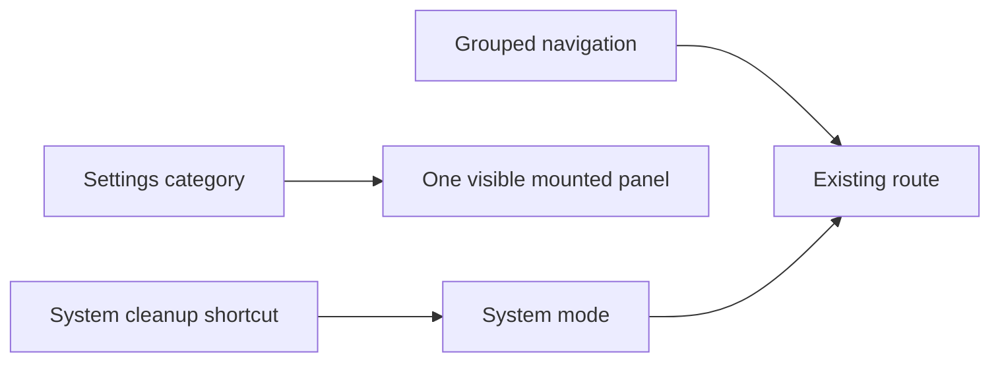

# Workspace navigation redesign — completed frontend scope

- Project: BroomSweepy
- Branch: main (`85620ca` at start)
- Origin: User requested improvement after the overall menu/UI audit: “진행해”.
- Origin source: current user turn; design contract `docs/design-refs/2026-10-20-experience-workspace-navigation.md`.
- Trigger: context compaction; this is continuity, not completion.

## Starting state at compaction

The new experience contract passes the design-plan validator. Grayscale dashboard and settings layouts were actually rendered at 1280×820 and 390×844 using IAB. Main scan and four quick actions fit in the desktop first view; settings has six categories and one visible form. Color variants are being prepared in `apps/desktop/ui-layout-preview.html`.

## Ownership and next actions

- `mac_settings_ui`: SettingsView.tsx + new SettingsView.css + unique navigation unit test. Six categories, mount panels once, hide inactive categories, preserve all callbacks and permission behavior. Approved to implement.
- `mac_settings_backend`: DashboardView.tsx + new DashboardView.css. Compact existing ring/hero/actions; preserve multi-drive FLIP and runtime state. Approved to implement.
- `mac_management_plan_review`: synthetic preview HTML only; three visual candidates after approved grayscale.
- Main: AppShell grouping/labels/current state, explicit system cleanup entry points, translations, whole-App safe mock fixture, browser verification, documentation, final tests.

## Boundaries

No install, commit, push, release or real OS preference change requested. Preserve pre-existing work and user data. Do not open demo-assets, personal daily conversations or .codex/loop-state.md. Mac settings remains five explicit local preferences; no Windows AI-removal implementation.

## Verification so far

- Experience contract validator: PASS.
- Grayscale desktop/narrow render: PASS (synthetic layout, not installed app).
- Production redesign checks: NOT RUN — implementation in progress.
- Vite dev server: 127.0.0.1:1431, exec session 33198.

## Session Memory Review

Architecture index and item 016 contain actual prior work. Doctor chart last visit 2026-09-29, under 30 days; no diagnostic rerun needed. Existing permission decisions 009/010 read before editing App.tsx and retained. New UI decision not yet settled; record it after actual implementation/render verification. No scoped new gotcha/learned observation or local skill candidate established yet; no backlog distillation performed.

## Completion update

Implemented grouped global navigation and correct parent current state; compact dashboard with existing drive FLIP; six settings categories retaining native panels; explicit system-cleanup entry points; accurate map-empty/disconnected copy; matching en/ja/zh translations and README/DESIGN updates. Two focused test files added. Safe actual-App fixture and candidate previews are separate development entries.

Verified frontend154/154, type/build, contract validator and diff whitespace. IAB1280×820/390×844 plus768/1024 settings: value retained, one model discovery, no main horizontal overflow, Mac/system cleanup, Windows menu conditions, multi-drive selection, native overlay inert/focus. Screenshot and limits: `docs/qa/workspace-navigation/verify-report.md`.

New decision017 and index written, linked to bounded conversation summary. Reusable CSS observation stays in017; no additional gotcha/learned backlog processing or project-local skill candidate (no matching project-specific target) performed. Re-search checks index→017→QA/source links. No installation, commit or push. Next if requested: native installation/UI smoke; Windows runtime and long-running memory verification remain separate work.

#tags: workspace-navigation, settings-categories, compact-dashboard, ui-qa, arch:017

## Current State Summary

Requested frontend reorganization is implemented and browser-verified. The installed app and Git remote have not been changed. Production UI engines, existing permission epochs and file execution safeguards are preserved.

## Feature/Flow/Decision Snapshot

Navigation selects existing route IDs; settings selects a visible category without changing native state. Explicit system-cleanup entry points set mode before navigation. Decision017 records why generic navigation must not force cleanup mode.

## Implemented Features

- Grouped sidebar with OS/opt-in visibility and parent current-page semantics.
- Compact dashboard and six-category settings workspace preserving existing state.
- System-cleanup routing correction and accurate empty/disconnected state presentation.

## Feature Boundary

Input is the same existing App props/native snapshots. Processing and storage still use the Rust/IPC engines; this task changes only routing/presentation and does not add access, scans or deletion behavior. Full map: `docs/design-refs/2026-10-20-sitemap-workspace-navigation.md`.

## Flow Diagram

## Important Context

The worktree includes substantial pre-existing Mac feature work, daily conversations and demo assets; do not sweep, stage or overwrite them. Development fixture data is explicitly synthetic and every IPC write is blocked. No new package or backend change was made by this UI task.

## Immediate Next Steps

No required frontend implementation remains. If the user requests installation, rebuild/replace the native app and smoke-test material, menu and settings there. Windows native runtime, real LLM flows and long-running memory checks remain separately scoped and must not be represented by browser mock results.

Post-integration review found a scroll-clipped icon-rail tooltip. AppShell now renders it outside the scroll container; actual768px keyboard focus/aria association/Escape dismissal passed. Existing route/settings tests remained green.
