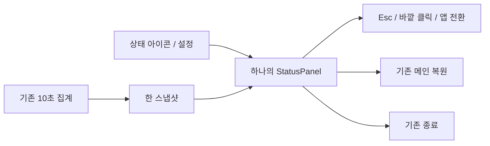
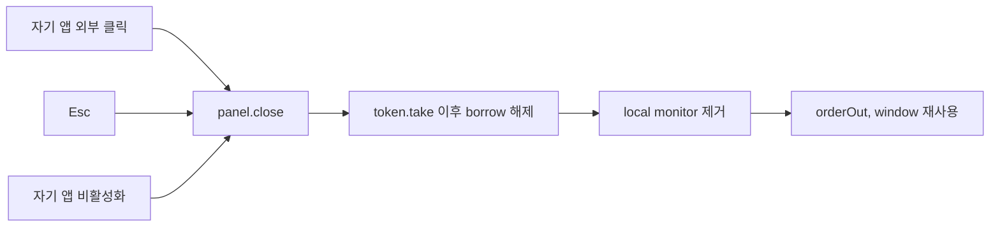

# Handoff: 메뉴 막대 유리 재질 수정 진행 중

## Release continuation — 2026-10-21

사용자가 메뉴바·다국어 수정본의 **v1.8.1 정식 공개, 커밋·푸시와 GitHub Release 게시**를 명시적으로 승인했다. 아래의 시간순 기록에 남은 “공개 권한 없음”은 당시 상황이며 현재 공개 승인에 적용하지 않는다. 현재 소스는 본체·보조 도구·MCP 버전1.8.1로 통일했고, 새 버전 회귀검사 포함 frontend218/218·TypeScript·production frontend build·Rust fmt·ARM64 locked metadata 검사를 통과했다. 최종 커밋의 양쪽 CI와 설치 파일 검증은 [릴리스 검증 기록](../qa/release-1.8.1-verification.md)에서 이어간다.

**기존 `/private/tmp/broomsweepy-popover-fix.0zALJg/Final-Colored-BroomSweepy.app`은 표시1.8.0 로컬 수정본**이다. 이를1.8.1로 설치하거나 공개하지 않는다. 이 Mac 설치 교체는 잠금 상태와 정상 종료를 다시 확인한 뒤, 최종1.8.1 CI DMG의 검증된 앱으로만 진행한다. v1.8.0 공개 태그·설치 파일은 보존한다. 실제 설치 검증이 남았음을 알고도 공개하겠다는 사용자 승인으로 배포와 설치 완료를 구분한다. 사용자 제외 경로와 정상 종료·DB 보존·잠금 우회 금지 경계는 그대로 유지한다.

## Session Metadata
- Created: 2026-10-21 12:41 KST
- Project: BroomSweepy
- Branch: main, HEAD29a5530
- Trigger: context compaction, same ongoing task; no release/push authority inferred.

## Origin

메뉴 막대 요약창이 바깥 클릭에도 닫히지 않고 너무 강한 회색 판으로 보인다는 사용자 요청. 중간 설치본에서 사용자가 직접 “바깥 클릭 닫힘. 그런데 회색진한 판임.”이라고 확인했고 실제 화면을 첨부했다. 정확한 세션 ID/원래 턴 시각은 제공되지 않았다. 근거: [집중 대화](../../conversations/2026-10-21-menu-bar-popover.md), 사용자 첨부 codex-clipboard-589e39fd-eda9-4e3b-991a-b8d8aec4c852.png.

## Current State Summary

LATEST15:06KST: final combined native build session63331 DONE4m50s. Stage `/private/tmp/broomsweepy-popover-fix.0zALJg/Final-Colored-BroomSweepy.app` now has signed ARM64 main602ff4871e4b7b85b222b2fb12f54689a0385becb6f2a10190b1049053231563; deep/strict signature PASS, document/MCP helpers still58d87.../b9a297...originalhashes. Final frontend216/216PASS, native12/12PASS, tsc/frontendbuild/Clippy PASS. **Mac locked** when CUA attempted normal CmdQ; user was asked to unlock. No Quit/swap/DBhashbaseline performed yet, old installed Regular79cdd... remains running. Do not force terminate or bypass lock; after user unlock resume exact safe install below. No Cargo running now.

14:40KST continuation: user rejected plain Regular screenshot (no beak/gray gauges), then accepted actual new native component preview “이 정도면 괜찮아”. Main wrote surface.rs (background-only Regular alpha.82/foreground alpha1/14pt beak+mask) and integrated worker gauge.rs (always colored/AX progress).12real-module tests and release Clippy PASS; production session15757 is still compiling, NOT installed. Existing installed app remains signed79cdd... Regular. No release/commit/push authority.025 now supersedes024; source/docs reflect accepted visual direction.

New user request while building: English UI still shows Korean; full audit and **fixing confirmed omissions approved**. native_glass_research owns only App.tsx/stale initial-t callback and new regression test; popover_dismiss_review owns only new lib/localizeAppText.ts + tests/localizeAppText.test.ts to localize app-owned backend messages. Main owns all view/component consumers, runtime audit, catalogs/docs/verification. Never translate user paths/content/history or macOS-owned dialogs. Mac preferences warning raw Korean physically confirmed; ENcatalog1597values contain0Hangul, existing catalog4testsPASSbutdoesnotcoverrawbackend. Source audits continue. Do not change Rust or dist during an active production compilation; new frontend bundle will need embedding in the final build.

Temporary NativeComponentPreview process53019 was stopped after acceptance (no saved user data), artifact retained under task temp. CUA selected /Applications app and navigated English Mac preferences; current native handle broomApp, English sidebar indices9–18. CUA full documentation refreshed this turn. Save/screenshots only actual CUA or exact user attachment. Installed/settings DB untouched so far.

최신13:27KST: UWB/local-only는사용자외부클릭/재질FAIL→복원, Clear+globalmouse는외부좌표click/Esc/Open/Quit통과하나사용자가가독성FAIL확인. Regular7m29s빌드/서명/DB3개보존PASS후 /Applications설치했다. signedhash79cddfe8ec4318310178cdf1a91e6bf55b4c167e04264a7790c3c0a23be6ba6b. 실제Settings열기/캡처글자노출확인. Regular외부자동click은AX에패널이남아불확정이며사용자최종가독성/물리적외부클릭응답대기. 열린Regular패널을사용자가직접볼수있게두었다. 부분검사/API로최종수락을추정하지말것.

## Session Memory Review
- Architecture preflight: SKIPPED — 생성 도구가 기억 본문 확인, 마지막 닥터22일 전(30일 미도래).
- Anchor index: RAN — macos.rs/DESIGN/021 등 확인.021의 새 단일 재질 패널 결정으로 대체 기록은 구현 검증 후 필요.
- Memory/index:021→022(UWB실패)→023(Clear가독성실패)→024(Regular)대체연결. 표시중마우스/generation/오류전파는023에서계승. DESIGN/experience/QA도실패이력과현재후보구분. MEMORY.md4956B.
- Retrieval: macos-menu-bar인덱스→024및021/022/023실제실패근거확인. 사용자 실제화면이API추정보다우선.
- Observations: 현재 집중 대화만 근거로 정제. 정확한 세션 ID가 없으므로 원본/기존 일별 백로그는 읽거나 정제하지 않음.
- Local skill candidate: 보류 — 이번 수정은 앱 네이티브 구현 문제이며 범위가 맞는 프로젝트 로컬 스킬 변경 근거 없음.

## Feature/Flow/Decision Snapshot

### Implemented Features

| 변경 | 동작 | 근거 | 검증 |
|---|---|---|---|
| StatusPanel | 아이콘 아래320×370, key-only, Esc/자기 앱 외부 클릭/앱 비활성화 닫힘 | menu_bar/status_panel.rs + macos.rs | Clippy·위치6tests·실제Esc/Open/Quit/재실행PASS, 최종외부클릭대기 |
| 단일 유리 배경 | UnderWindowBackground/BehindWindow/Active, tint 없음, 네이티브 글자/컨트롤 | macos.rs | 설치형캡처확인, 실제desktop합성 사용자확인대기 |
| 기존 집계 | CPU/RAM/root disk10초, 한 스냅샷 | 기존 sampler 무변경 | 종전 계약 유지 |

### Feature Boundary

파일/프로세스 검색, 전역 입력 감시, 시스템 접근성 변경, WebView 추가, Windows 트레이 변경은 하지 않는다. 로컬 마우스 monitor만 열려 있는 동안 동작하며 원본 이벤트를 반환한다. 바깥 앱은 own NSApplication resignActive 알림으로 닫는다. 닫을 때 monitor를 take한 뒤 borrow를 놓고 제거한다.

### Menu / Screen Map

macOS 메뉴 막대 아이콘 또는 설정→패널 열기 → 상태 요약 → 닫기/메인 열기/명시적 종료. 메인/설정 메뉴는 변경하지 않는다.

### Composition Diagram

### Flow Diagram

### Decision Records

021 NSPopover+tint →022 단일 NSPanel 재질: 사용자가 실제 회색 판을 확인했으므로 더 어두운 덧칠 기각. 전체 창 alpha는 글자까지 흐려져 기각. 중첩 blur/WebView/새 기능은 불필요.021 SUPERSEDED/022 CURRENT 및양방향연결 완료. 기존007의 단일 native material 원칙은 유지.

## Work Completed

- 사용자가 중간본의 실제 바깥 클릭 닫힘 PASS 확인.
- 중간본 ARM64 설치/서명, 닫힌 앱DB3개 swap 전후 byte동일 확인. 원본 복구본 보관.
- status_panel.rs 위임 구현 완료; 메인 통합과 tint 제거 완료, format 적용.
- Cargo에block2 및AppKit panel/effect/layer 기능 추가. quartz-core 캐시 없어 공식registry에서 한번 받은 뒤 Clippy 실행.
- 최종 Clippy/format/diff·실제모듈위치6tests/production4m30s·ad-hoc서명PASS. 새설치전후DB3개동일.
- 실제native열기/Esc/메인복귀/3회열기/명시적Quit로process종료/재실행과기존On값확인. checkbox/OS설정은변경하지않음. Tabfocus이동안되어완전한키보드접근성은NOT VERIFIED.

## Important Context / Safe Install

- 현재 /Applications/BroomSweepy.app은Regular본79cddfe8ec4318310178cdf1a91e6bf55b4c167e04264a7790c3c0a23be6ba6b. production완료/서명PASS/실제실행/기존환경설정On확인.
- /private/tmp/broomsweepy-popover-fix.0zALJg/Previous-BroomSweepy.app=원래공개1.8.0; KnownDismiss-BroomSweepy.app=중간NSPopover(바깥닫힘사용자PASS); Rejected-Panel-BroomSweepy.app=UWB/local-only실패본6ce058...; Rejected-Clear-BroomSweepy.app=Clear가독성실패aef61c... . 모두복구용유지. 앱자료DB는각swap마다정상종료상태비교PASS.
- native정상종료 후 DB3개 hash baseline→swap→동일 확인완료. DB내용은읽지않음.
- node/Tauri는 x64, Rust는ARM64. production은 apps/desktop에서 tauri build --no-bundle --config '{"build":{"beforeBuildCommand":""}}' -- --offline --locked. CARGO_BUILD_JOBS=1/CARGO_INCREMENTAL=0/CARGO_PROFILE_RELEASE_DEBUG=0/APPLE_SIGNING_IDENTITY=-. 통상6–8분, 병렬Cargo 금지.
- 기존 ARM641.8 helpers/resources는그대로.공개Release/태그/설치파일 수정 금지.
- .codex, demo-assets, conversations/2026-10-{12,20,21}-codex.md는 사용자 제외 파일: 읽기/스테이징하지 않음.
- CUA app은 전체 /Applications 경로로 선택. 창 단독 캡처는 desktop backdrop 합성의 완전한 증거 아님. 직접 아이콘 조작은 현재AX제약. Codex앱선택은 안전차단→재시도/우회금지.

## Immediate Next Steps

LATEST BLOCKER: await the current unlock reply (question says combined build/sign done). On unlock: fresh CUA `/Applications/BroomSweepy.app` state, normal CmdQ (do not AX-read afterward and accidentally relaunch), exacthostprocessabsence; store closed hash3DB baseline privately. Validate installedmain79cdd... + stage602ff... and unique backup path`Previous-Regular-BroomSweepy.app` absent. Move old installed bundle into that private tempbackup and staged final to /Applications, restoring old on movefailure. Verify signature/main/helpers/closedDB3unchanged before launch. Native launch via CUA, ENMacwarning + app protection reasons and Settings6categories, newEnglishbubble/AXgauge/beak/Esc/Openmain/outsideclick. Saveactualscreenshots/QA, preserveuserENchoice. If later no unlock, final report must explicitly say **not installed**. Temporary nativepreview is stopped. Userdata/permissions/history untouched by this turn.

15:03KST update: all source workers finished/frozen. Final full frontend suite216/216PASS including3actual Provider tests; source production frontend/build and tsc PASS. Final native63331 still compiling desktop crate (no source change since it began). Main only edited docs/memory/tests afterward. Staged Final-Colored-BroomSweepy.app exists, copied from original verified bundle, but still contains original executable until final build replacement/signing. Native runtime/DB-preserving install remains next; not yet completed.

15:00KST continuation supersedes the older steps below: native colored-bubble production5m28s completed but not installed; combined frontend fixes then finished `npm run build`. Full frontend212tests PASS and final expanded localization subset23PASS; TypeScript PASS. Helper frozen at222exact/55templates/4locales. Actual LanguageProvider integration test is being added by native_glass_research (new test file only), other source workers finished. Final combined native production is currently session63331 using the same single-job/offline/no-bundle command; no other Cargo running. After success: replace the staged main in task-temp Final-Colored-BroomSweepy.app, sign/verify, native Quit installed Regular, hash3closedDBs, backup installed Regular to unique path and swap, recheckDBs/helpers/signature, relaunch, validate English Mac warning/app protection reasons + new bubble gauges/beak/Esc/open/outside-click. Preserve user English language choice. Language QA docs/new026 now track implementation and pending final install. No user data cleanup/commit/push/release.

1. Regular실제사용자최종확인응답을기다려QA/대화/024/이문서에반영. 물리적닫힘/가독성불편이남으면그범위만수정하고미검증PASS금지.
2. CUA창단독캡처06은읽히지만desktop질감증거는아님. Clear에서만통과한외부좌표click은RegularPASS로복제하지말것. Chrome프로필데이터는선택/수정/저장하지않음.
3. commit/push/release권한없음. 사용자제외파일은계속읽기/스테이징금지.

## Related Resources

- [QA](../qa/menu-bar-2026-10-21/review.md)
- [Native experience](../design-refs/2026-09-07-experience-macos-menu-bar.md)
- [Native source](../../apps/desktop/src-tauri/src/menu_bar/macos.rs)

#tags: 메뉴바, 가독성, 외부클릭, 빌드중, arch:021, arch:022, arch:023, arch:024, supersedes:#clear-panel-dismissal
