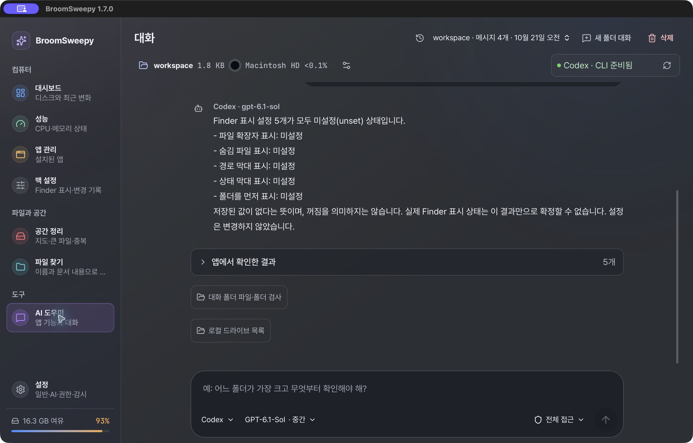
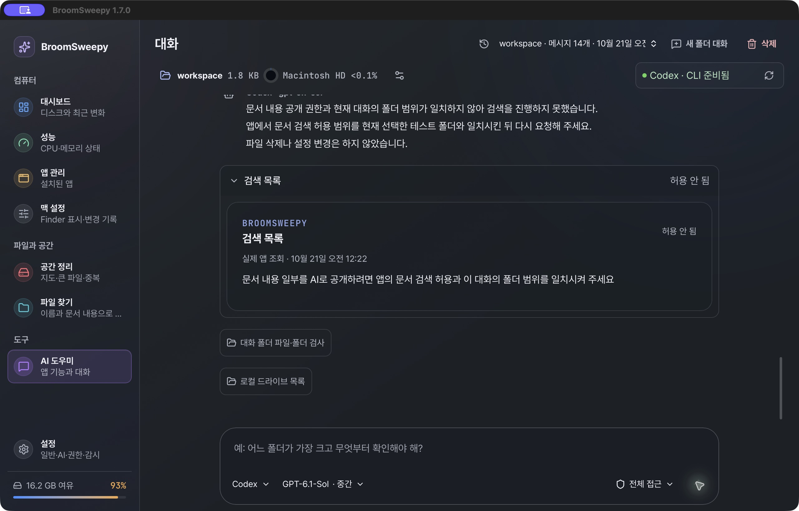

# Mac 설치 교체와 실제 채팅 사용성 검사

2026-10-20 시작, 2026-10-21 00:25 KST 검사 종료 · Codex · Apple Silicon macOS26.4/8GiB.

판정: 설치 교체와 주요 실제 채팅 흐름은 통과했다. 그러나 모든 기능의 채팅 단독 제어·문서 내용 검색의 성공 경로까지 완료한 것은 아니다. 사용성 P2 두 건을 확인했으며 이 검사에서는 제품 코드를 수정하지 않았다.

## 요청·범위

사용자: “맥교체하고 테스트 진행. 채팅창에서도 다 제어가 되는지 사용하기 편하게 되어있는지 확인”. 최신 소스의 로컬 ARM64 설치와 실제 Codex 채팅/앱 기능 연결을 검증한다. 공개 릴리스·원격 CI·커밋·푸시는 요청되지 않았다. Product Design audit 기준으로 이번 실행에서 캡처한 실제 설치 화면만 사용성 근거로 사용한다.

## 안전한 시험 대상

전용 루트: `/private/tmp/broomsweepy-installed-chat-audit-I9gHOi/workspace`.
합성 파일4개와 폴더2개만 만든다. 사용자 자료·인증정보·원래 대화 내용을 모델 시험에 넣지 않는다. 사용자가 실제 휴지통 이동을 승인한 대상은 이 루트의 `remove-me.txt` 하나뿐이다. 나머지3파일은 해시로 보존을 확인한다. OS 설정 변경·앱 제거·사용 중인 다른 앱 종료·휴지통 비우기는 수행하지 않는다.

| 파일 | 시작 SHA256 |
|---|---|
| large-report.txt | 6c986dc310eebf20d6f0ec0b009a5058b61a4cc6409922305219ea3d73619dcf |
| readme.md | f8601b25477085d010b2fb42ac4d1b7429a92ef9f24c1f55c23125f5261e176c |
| keep/keep-note.txt | e193e3a11ad94ca017ab3cd48ba001a90aaf45d79c0f1502ce24840e0942d55b |
| remove-me.txt | a8f7b7b728bc6f8a84b6247099e656e219a2ad3a11c322e9a0039694993607c6 |

## 교체 준비

시작 설치본은 Oct11 arm64/1.7.0이고 main SHA256 `6311753af76b4d54142a5551f62c81c64ef086bf1ab7d1f85935afc05a44e48b`. 새 빌드도1.7.0 개발본이므로 해시·UI·실행 경로로 교체를 구분한다. 빌드는 jobs1/offline/no-incremental app-only이며 DMG는 만들지 않는다. 사용자 Application Support 데이터는 교체하지 않는다.

준비 staging: `/Applications/.broomsweepy-install-Vcl6cs`. 새 번들의3개 실행 파일·서명 검증을 통과한 뒤 정상 종료하고 `renamex_np(RENAME_SWAP)`로 교대했다. 기존 앱을 별도 복구 경로로 이동해 보존했다. 실제 결과는 아래와 같다.

## 소스에서 확인한 제어 경계 (실제 동작 PASS와 구분)

- 내장 채팅은 strict JSON→공통 app dispatcher→결과 분석이며 외부 MCP wire를 경유하지 않는다.
- 파일·빈 폴더·앱 본체의 예/아니오와 메모리/프로세스/시스템 정리의 별도 확인은 서로 다르다.
- Finder5개는 채팅 조회만, Apply/Restore는 로컬 버튼만 제공한다.
- `ui.view`는 현재 자동 전환이 아니라 결과 카드의 화면 보기 버튼이다.
- 일반 생성/이름변경/이동, CPU 청소, OS/보안 변경, 영구 삭제를 채팅이 제공한다고 주장하지 않는다.
- 실제 성능/앱 조회는 제한된 앱 이름·사용량 행이 모델로 전달될 수 있다. 폴더 시험은 합성 이름·용량만 사용한다.

## 설치·MCP 결과

- ARM64 app-only release 빌드 exit0(본체7m49s). 최초 resource-seal 검증 실패 후 기존 단일 entitlement로 MCP→worker→app ad-hoc 재서명, deep/strict PASS. 공증/DMG 배포가 아니다.
- `/Applications/BroomSweepy.app`를 정상 종료 후 staging과 atomic swap했다.3개 실행 파일이 새 bundle과 cmp 동일, 설치본 서명 PASS. main SHA256 `d8a54253a5e15fbcc218ff0ffcc79ab00726c72d2f11b299c0302abe750ad069`. 새 main PID89925.
- 원래 앱은 `/private/tmp/broomsweepy-installed-chat-audit-I9gHOi/Previous-BroomSweepy.app`에 보존했다. 이동 뒤 이번에 만든 빈 staging 디렉터리만 제거했다.
- 앱 종료 상태의 대화/권한 main DB SHA256은 설치 교체 전후 동일했다. 대화 DB `bdaf416b831604cabbdcb7d8a21b10fcf616e705252c2991ea26d48408f0b337`, 권한 DB `e5fa8684cdd298ff14fcadf5e9dcd2644350910017facb3d768ba33af9b7ecf2`. 이후 실행·새 시험 대화 저장에 따른 정상 DB 변경과 구분한다. 원래 대화 내용을 추출/수정하지 않았다.
- 기존 대화43메시지와 GPT-6.1-Sol/중간/전체 접근 선택이 복원됐다. 기존 대화 화면은 개인정보 가능성 때문에 공개 캡처하지 않았다.
- 설치된 새 MCP를 직접 stdio로 연결한 `installed-os-settings-flow.mjs` exit0.12도구/27capabilities/format2/14876B, detail8918/9083B. 실제 Finder5행 bool/null/state, Mac의 Windows unsupported0행을 확인하고 local presentation/경로/진단 비노출·무변경을 검사했다. 외부 inspection 허용은 기존 값을 유지했고 변경하지 않았다.
- 시스템 기본 Node는 x64여서 실제 하네스는 Codex 번들의 arm64 Node(`/Users/dannysmacair/.cache/codex-runtimes/codex-primary-runtime/dependencies/node/bin/node`)를 사용했다. 새 CLI/모델/로그인은 설치하지 않았다.
- 하네스 최종 리뷰에서 종료 중 늦은 오류 누락·stdio 종료 미확인 가능성을 발견해 새 검사 파일만 보강했다. child close 관측/2초 timeout 실패·stdio 해제·잔여 frame/late fatal 검사를 추가했다. ARM64 Node 합성4/4 PASS(정상exit0, late malformed exit1, 개행 없는 frame exit1, 후손 stdio 유지 exit1/약2.3s), node --check PASS. Main이 수정본으로 **실제 설치 sidecar를 다시 실행해 exit0**·동일12/27/5/unsupported0 계약을 재확인했다. 제품 소스·설치본 변경 없이 검사 도구만 수정한 것이다.

## 실제 채팅 진행

새 `workspace` 세션을 실제 UI에서 만들고 Codex/GPT-6.1-Sol/중간으로 질문했다. 캡처는 이번 설치본의 실제 Wry 화면이며 합성 IPC/모델 답변을 사용하지 않는다. 모델에 전달한 파일 요약은 위 합성 폴더뿐이다.

1. **설치·이전 상태 복원 — 정상.** 새 main PID89925와 실제 설치 경로를 확인했다. 기존 대화·CLI/모델/중간 강도·전체 접근이 복원됐다. 대화/권한 DB의 교체 전후 보존은 위 해시로 확인했다.
2. **큰 항목 조회·진행 표시 — 정상.** “여기서 가장 용량이 큰 파일과 폴더를 앱으로 새로 검사해서 알려줘. 삭제나 삭제 검토는 하지 마.” → large-report.txt1389B/keep117B. 직계5항목·하위4파일·빈폴더1·읽기오류0과 일치한다. 삭제/검토0. 실제 단계 표시/경과7s/하단 입력·취소를 관찰했다.
3. **같은 결과 용량지도 — 정상, 복귀 표시 문제 별도.** 채팅 카드에서 지도에 이동해 동일1.8KB/직계5/파일4/빈폴더1과 순위를 확인했다. 채팅 복귀 시 메시지2개와 native workspace 결과를 복원했다. 아래 P2-1은 원래 턴의 연결 소실 문제다.
4. **Finder5개 조회 — 정상.** “Finder 표시 설정 5개를 앱에서 조회해서 현재 저장 상태를 알려줘. 아무 설정도 바꾸지 마.” → 모두 unset이며 꺼짐과 다르고 실효 상태를 확정할 수 없다고 설명했다. 실제 Mac 화면의5행과 일치했다. Apply/Restore를 누르지 않았고 변경 기록은 비어 있었다.
5. **성능·앱 목록 — 정상, 측정/목록 한계 명시.** “현재 CPU와 메모리 사용률을 앱에서 조회하고, 설치된 앱 중 BroomSweepy만 찾아줘. 삭제나 앱 종료는 하지 마.” → CPU38.6%(약7분15초 측정 구간), RAM약72.3%·5.78/8GiB, BroomSweepy1.7.0 1건. 앱 용량 미제공·목록 일부 누락 가능성도 설명했다. 순간 CPU값·완전한 앱 목록을 보장하는 시험이 아니다.
6. **자체 메모리 정리 — 실행 정상, 채팅 단독은 아님.** “BroomSweepy 앱 자체의 사용하지 않는 메모리를 정리해줘. 다른 앱을 종료하거나 파일을 삭제하지 마.” → 검토 준비, ‘검토 열기’→로컬 모달→‘앱 메모리 정리’로 실행. “현재 반환 가능한 자체 메모리는 없습니다” 완료를 확인했다. 취소가 기본 포커스였다. 다른 앱/WebKit/CLI/시스템 전체 메모리나 CPU 정리가 아니다. 회수량이 없는데 확보했다고 주장하지 않았다.
7. **승인된 단일 파일 휴지통 이동 — 정상.** “remove-me.txt 삭제해” → 현재 전체 접근 설정에 따라 재검사 후 추가 예/아니오 없이 요청1개 중1개 이동 완료. 항목별 결과가 정확한 승인 경로였다. source가 없고, 나머지3파일 SHA256이 시작값과 동일하며 두 폴더도 남아 있음을 별도 셸로 확인했다. 사용자 자료·다른 테스트 파일·휴지통 비우기를 건드리지 않았다. OS 휴지통 복원 자체는 시험하지 않았다.
8. **문서 내용 공개 경계 — 차단 정상, 검색 성공 경로 NOT RUN.** 합성 폴더에서 ORCHID-SYNTHETIC-7421 본문 검색을 요청했으나 permission_required. 실제 답변과 카드 모두 문서 공개 root와 대화 root 불일치를 설명했다. ‘전체 접근’이 본문 공개까지 허용하지 않는 정상 경계다. 기존 허용 버튼은 다른 색인 root까지 함께 허용할 수 있어 누르지 않았다. 권한을 넓히거나 개인 문서를 검색하지 않았다. 아래 P2-2 참조.
9. **파일 이름 검색 — 정상.** “문서 내용은 읽지 말고 현재 테스트 폴더에서 이름에 report가 포함된 파일을 앱으로 찾아줘. 삭제나 설정 변경은 하지 마.” → large-report.txt1389B 1개. 실제 native 파일 결과도1개·선택0개·검토 버튼 비활성이었다. 마지막 대화16메시지, Codex 준비됨, 실행 중 작업 없음으로 남겨 뒀다.

## 사용성 발견 사항

### P2-1 — 복귀한 이전 파일 결과의 출처가 불명확함

파일5개 조회→Finder 질문→다른 화면→채팅 복귀 시 이전 파일 workspace가 Finder 최신 답변 아래 ‘앱에서 확인한 결과5개’로 표시됐다. 원래 턴 식별자가 복원되지 않아 결과가 최신 답변의 근거처럼 보인다. 실제 Finder5행 카드와 혼동할 수 있다. 메모리 완료 뒤에도 같은 이전 파일 결과를 관찰했다.

정적 근거: `AssistantView.tsx:332,644`의 턴·도구 초기화, `:347`의 파일 workspace 복원, `:1280`의 null key 하단 fallback, `:1099`의 일반 제목. 최신 턴에 직접 재귀속하는 구현은 아니며 historical/busy/readOnly 가드는 유지되므로 이것만으로 삭제 권한이 활성화된다는 뜻은 아니다. 원래 턴 연결을 보존하거나 명확히 구분한 ‘이전 파일 조회 결과’·시각을 표시하는 수정을 권장한다.

### P2-2 — 문서 공개 범위를 현재 대화에서 맞추기 어려움

‘전체 접근’ 상태에서도 본문 공개는 별도다. 차단은 올바르지만 결과 카드에는 현재 폴더만 확인·허용하는 동작이 없으며, 화면 이동/설정에서 사용자가 범위를 맞춰야 한다. 기존 연결·권한 패널은 ‘외부 MCP’ 설명 아래에 있고 실제 토글은 현재 대화가 아니라 기존 fileCatalog/documentIndex root를 함께 설정한다. 현재 합성 폴더만 허용한다고 보장할 수 없어 이 검사는 변경하지 않았다.

정적 근거: `app_tools_search.rs:144,355`의 정확한 canonical root 비교·검색 후 재검사, `App.tsx:810`의 검색 허용 토글, `ControlStatusPanel.tsx:249`, `AssistantAppToolCard.tsx:146`. 현재 대화 root와 공개 대상 경로를 직접 보여 주고 개별 본문 공개 동의로 연결할 필요가 있다. 전체 접근이 본문 전송 동의를 대체해서는 안 된다.

## 실제 캡처

이번 설치본을 Cua AX+화면으로 캡처하고 저장한 원본 바이트를 다시 열어 확인했다. 합성 화면/후처리/모델 답변 대체는 없다. 첫 단독 screenshot timeout 후 재연결했고 combined AX+screenshot은 성공했다. 개인정보가 없는8장을 `screenshots/2026-10-21-installed-chat/`에 그대로 보존했다(총2.5MiB).

| 파일 | 확인 내용 |
|---|---|
| [01-installed-mac-settings.png](screenshots/2026-10-21-installed-chat/01-installed-mac-settings.png) | 실제 Mac 전용 메뉴·Finder5행 |
| [02-chat-progress.png](screenshots/2026-10-21-installed-chat/02-chat-progress.png) | 실제 분석 단계·7s·하단 입력/취소 |
| [03-shared-map.png](screenshots/2026-10-21-installed-chat/03-shared-map.png) | 같은 검사 결과의 지도 |
| [04-finder-chat.png](screenshots/2026-10-21-installed-chat/04-finder-chat.png) | Finder 답변·이전 파일 결과 출처 문제 |
| [05-memory-result.png](screenshots/2026-10-21-installed-chat/05-memory-result.png) | 실제 자체 메모리 정리 완료·반환 가능 없음 |
| [06-trash-result.png](screenshots/2026-10-21-installed-chat/06-trash-result.png) | 승인 파일1개 이동 완료 |
| [07-document-permission.png](screenshots/2026-10-21-installed-chat/07-document-permission.png) | 실제 문서 공개권한 차단 |
| [08-name-search.png](screenshots/2026-10-21-installed-chat/08-name-search.png) | 실제 이름 검색 답변·native 결과1개 |

## 한계·후속

- 내장 채팅은 실제 공통 app dispatcher를 사용하지만 외부 MCP wire를 경유하지 않는다. 설치 sidecar의 실제 stdio12도구/27capability 검증과 내장 Codex 채팅 시험을 별개로 통과했다.
- Finder Apply/Restore는 로컬 UI만, 메모리 정리/프로세스 종료/시스템 정리는 준비 후 로컬 확인이 필요한 계약이다. 모든 기능이 ‘대화 한 번으로 실행’되지는 않는다.
- NOT RUN: 문서 본문 검색 성공, 실제 앱 제거/관련 데이터 삭제, 다른 앱 종료, OS 설정 쓰기/복원, 영구 삭제, 장시간 RAM·WebKit·CLI 전체 soak, Windows 실기/설치, 모든 공급자/모든 기능의 완전한 종단시험. 이 시험으로 안전성·접근성 전체 준수를 인증하지 않는다.
- Mac 설정으로의 예상 밖 화면 이동은 관찰했으나 현재 소스에 자동 이동 경로가 없고 사용자 동시 조작 가능성을 배제하지 못했다. 확인된 버그로 집계하지 않는다.
- 앱·권한·모델 선택은 원래 값을 유지했다. 테스트 대화와 남은 합성 파일/기존 앱 rollback은 보존했다. 기존 dirty 작업·기억·개인 대화는 삭제하거나 커밋하지 않았다.
- 최종 설치본 codesign deep/strict·main SHA256·프로세스 생존·보존3파일 SHA256을 재확인했다. 기록/인계 검사는 READY, git diff --check PASS다. 실제 대화/화면 검사는00:25 KST에 정리했고 하네스 종료 회귀 보강·실제 MCP 재검증을 뒤이어 마쳤다.
- 다음 수정 우선순위: P2-1 결과 출처/턴 복원 → P2-2 현재 폴더 본문 공개 안내·정확한 범위 → 승인된 합성 문서 검색 성공 경로. 권한을 우회하거나 허용 범위를 조용히 넓히는 해결책은 제외한다.

#tags: 맥설치, 실제채팅, 사용성감사, 합성파일, 데이터보존
