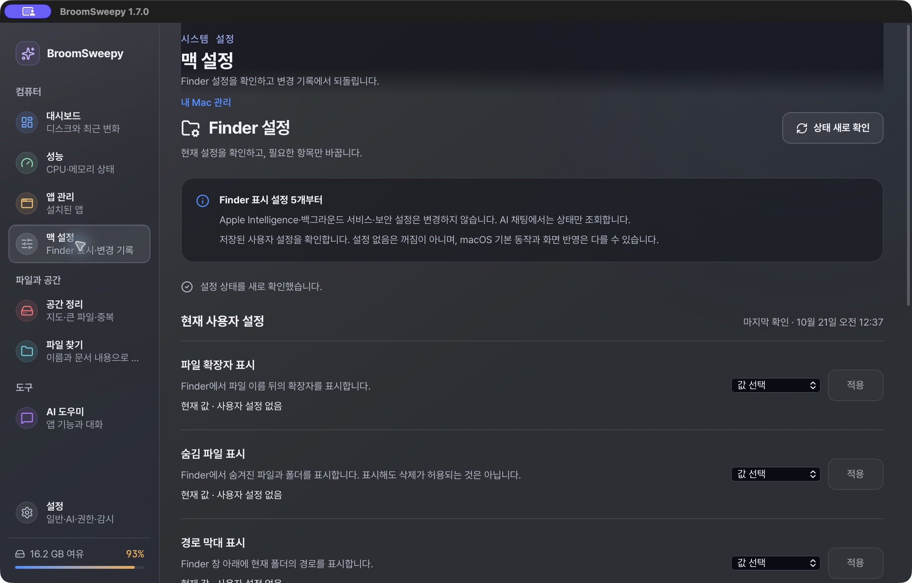
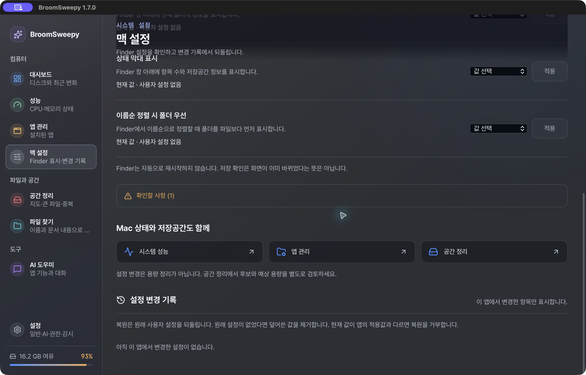

# Mac 설정 화면 제한 사용성 감사

2026-10-21 · Codex · 설치본 BroomSweepy1.7.0 · 원본 캡처 기반. 목적은 사용자 피드백을 확인하고 디자인 시안으로 이어가는 것이다. 제품 코드/실제 OS 설정은 변경하지 않았다.

## Scope / user goal

Mac 설정 진입→기능 찾기→상태·조작 이해→변경 기록 재발견. MacManagementView 한 화면과 현재 AppShell 헤더에 한정한다. 사용자에게는 실제 적용 가능한 기능과 단순 다른 메뉴 이동이 구분돼야 한다.

## Numbered steps

1. **설정 첫 진입 — 개선 필요.** 제목·하위 제목·관리 범위·조회 완료 안내가 반복돼 첫 화면에서 실제5개 중2개 정도만 보인다. 저장값 부재를 OFF로 단정하지 않는 점은 좋으나, 같은 설명/상태가 행마다 반복되어 기능 스캔이 늦다. 값 선택→적용이라는 주 행동은 먼 오른쪽의 작은 select/비활성 버튼으로 후퇴해 있다.

2. **하단 탐색 — 개선 필요.** 스크롤하면 상위 ‘맥 설정’ 제목과 설명이 실제 설정 내용 위에 겹친다. 성능·앱 관리·공간 정리 버튼은 기능 실행이 아니라 기존 메뉴 이동이다. 실제 설정 변경 기록/복원보다 중복 이동이 먼저 나타난다. 코드의 onNavigate는 화면 이동이며 공간 정리만 system모드를 선택한다. 클릭 실행/OS 변경은 하지 않았다.

## Highest-impact findings

| Priority | Evidence | Finding | Proposed change |
|---|---|---|---|
| P1 | Step2 | sticky 상위 제목이 조작·본문을 가림 | 제목1개·일반 흐름, 스크롤 중 겹침 제거 |
| P2 | Step1 | 중복 카피가 기능·주 행동보다 강함 | 기능별 묶음·아이콘·짧은 상태·인접 조작 |
| P2 | Step2 | 중복 메뉴 연결이 실제 관리 기능처럼 강조됨 | Mac 설정 내부에서 직접 조작, 중복 바로가기 제거 |
| P2 | Step1 | 비활성 적용의 이유가 바로 읽히지 않음 | 아직 미선택/초안/적용됨을 짧게 구분, 적용 경로는 유지 |

## Accessibility risks / limits

헤더 겹침은 포커스/텍스트 가림 위험이 있다. 이 감사에서 전체 키보드 순환·스크린리더·수치 대비·light/narrow 설치본·실제 Apply/Restore는 시험하지 않았다. 모든 접근성 준수나 실제 설정 성공으로 확대하지 않는다. semantic 상태/명시적 Apply·복원·null 보호는 소스에서 확인한 보존 계약이다.

프리뷰는 [Experience Contract](../../design-refs/2026-10-21-experience-mac-control.md)와 [brief](../../design-refs/2026-10-21-brief-mac-control.md)를 따른다. 시안은 OS 연결 없이 동작을 비교하며 제품 변경의 완료 증거가 아니다. 검토 참고: [Web Interface Guidelines](https://raw.githubusercontent.com/vercel-labs/web-interface-guidelines/main/command.md), 2026-10-21 조회.

## Preview steps

3. **무채색 구조 — 통과.** desktop/narrow에서 기능 묶음과 조작을 확인했다. [desktop](03-wireframe-desktop.png), [narrow](04-wireframe-narrow.png). 선택 전 안내의 모호함은 styled안에 짧은 라벨로 보강했다.
4. **세 방향 비교 — A 선택.** [A](05-a-desktop.png), [B](06-b-desktop.png), [C](07-c-desktop.png). 실제390px 캡처는08-a/b/c-narrow.png. A가 현재5개에 가장 직접적이며 B/C의 스크롤·단계 부담은 [비평](../../design-refs/2026-10-21-critique-mac-control.md)에 기록했다. 이후 사용자 “추천대로가자”로 추천 A가 확정됐다.
5. **모의 적용·복원 —3/3 통과.** 세 안에서 선택→적용→기록→null복원을 실제 UI로 실행했다. 실제 Mac 변경 아님. 마지막 [A 초안/적용 버튼](09-a-pending.png)을 preview로 열어 뒀다. 제품은 그대로다.

## Selected A product implementation — 01:10–01:17 KST

위1–5는 비교 단계의 기록이다. 아래는 실제 제품 MacManagementView와 AppShell을 사용한 격리 시험이며 native command를 mockIPC에서 모두 차단했다. 실제 Finder 쓰기/복원 성공을 주장하지 않는다. 직접 Playwright CLI/MCP는 별도 허가 없이 실행하지 않았고 Cua IAB로 화면/동작을 확인했다.

| Check | Actual result / evidence |
|---|---|
| Null and draft | 최초10개 choice aria-pressed=false, Apply5개 disabled. On 선택 후 현재값 null 유지·아직 적용 안 됨·applies0, [initial](10-a-component-desktop.png), [pending](11-a-component-pending.png) |
| Apply/history/restore | 명시 Apply후 applies1, 현재true/history1; 키보드 Return으로 기록 heading 포커스. 복원후 restores1/null/양쪽 미선택. [history](12-a-component-history.png) |
| Duplicate/busy/late result | slow상태 dblclick에 applies1, 전체 변경 잠금; 두번째 쓰기 중 fixture화면 이탈 후 완료되어도 외부 시험 화면 유지 |
| Managed/type/read issue | 원인을 행에 표시하고 해당 버튼만 잠금. 경고도 접지 않음. [mixed](13-a-component-mixed.png) |
| Failures/recovery | write-error·external-change·restore-error 모두 alert/stale/쓰기잠금. Refresh 성공후 초안 초기화·실제 최신 mock값으로 회복. load-error는 추정값/편집행 없음. unsupported는 편집행 없음. [write failure](14-a-component-error.png) |
| 1280×820 real App composition | h1 ‘맥 설정’1개, Apply5개 bottom260/338/416.5/547/625.5px, 전부 첫뷰포트. 다른메뉴 연결 없음. [actual App/mock native](16-a-app-shell.png) |
| Header overlap | position=relative, mainScroll101일 때 headerTop=-101. 기록으로 focus 이동, 제목이 조작부 위에 남지 않음. [scroll](17-a-app-scroll.png) |
| Narrow390×844 | component/App 두 경로에서 상태/선택/Apply 재배치. 가로 overflow=false, 버튼 최소44px·본문14px 이상. [component](15-a-component-narrow.png), [App](18-a-app-narrow.png) |
| English/narrow | 긴 label wrap·조작부 범위left35/right355px, 가로 overflow없음. [English](19-a-en-narrow.png). 시험 전용h1/leave버튼은 한국어 고정, 제품Shell은정상locale사용 |
| Font | 실제 fixture 코드의 document.fonts.load로450/650 각count1/status loaded, family Pretendard Variable. ‘가나다 BroomSweepy’ 시각 관찰. per-glyph width/전체글리프 보증 아님 |
| Keyboard | Space로 draft 선택, Return으로 history진입, 실제 heading focus확인. 모든 focus순환/스크린리더 시험 아님 |

독립 reviewer도16–19의 네 실제캡처를 열어 확인했고 남은P1/P2 시각 결함은 관찰하지 못했다. root도 원본바이트 캡처를 직접 관찰했다. 시각수정은 미지원 heading h3→h2 한 차례이며 레이아웃 방향을 혼합하지 않았다.

## Source verification

- `npm run check`: exit0. Final production build의 tsc/Vite는 설치검증 기록에 별도 기록한다.
- ARM64 Node의 `node --test --experimental-strip-types tests/*.test.ts`: **184/184 PASS**, exit0. 새 Mac real-View/fake-hook 회귀14개 포함. null expectedValue·same-render lock·stale/refresh·generation역전·late read/apply/restore·restore ID/충돌 위임을 검증했다.
- 수정된 기존 `scripts/test-mac-settings-ui.mjs`: node --check PASS, 직접 browser runner **NOT RUN**(Cua 검증으로 대체). 옛10/10결과를 이번실행으로 재사용하지 않는다.
- `git diff --check`: PASS. 새 의존성 없음, native/API/권한 로직 변경 없음.

## Remaining limits

실제 OS설정 쓰기·복원, Windows runtime, 장시간 메모리, 모든색상 대비/스크린리더/실기좁은Mac창은 NOT RUN. 앱은 Dark 고정이며 새 light theme를 만들지 않았다. CSS reduced-motion와 jump분기는 보존했지만 현재 IAB에 media emulation기능이 없어 강제 reduced-motion실행은 NOT RUN. 웹 opaque와 설치 native-glass는 구분한다.

## Installed app

2026-10-21 01:28–01:30 KST · **PASS**. `CARGO_BUILD_JOBS=1 CARGO_INCREMENTAL=0 CARGO_PROFILE_RELEASE_DEBUG=0 CARGO_NET_OFFLINE=true npm run tauri build -- --target aarch64-apple-darwin --bundles app` 최종 exit0. 최종 tsc/Vite PASS, release Rust8m39s. 기존 unused 함수2개와 큰JSchunk 경고는 남아 있으며 이번 UI작업에서 임의 정리하지 않았다. 미지원 heading의 h2와 matching CSS가 최종dist에 반영됐음을 확인한 뒤 설치했다.

- Info.plist정상, main/MCP/document-worker3개 arm64. 기존 entitlements로 sidecar→worker→app ad-hoc 서명 후 deep/strict PASS. 공증·새GitHub릴리스 아님.
- 정상종료→정확한 staging bundle→renamex_np atomic swap. 설치3실행파일은 freshbundle과 cmp동일, 설치main SHA256 `613b4e2ae1dbeea83bd89077e62add2d9a7655b8b8eba577de87e6d173c385e5`.
- 닫힌앱의 assistant-sessions/permission-settings/developer-tools3DB는 swap전후 바이트동일. DB내용을 출력·수정하지 않았다. 재실행 후 정상 앱 저장 동작과 구분한다.
- 직전설치본 보관: `/private/tmp/broomsweepy-mac-control-a-kIjV2d/Previous-BroomSweepy.app`, main SHA256 `d8a54253a5e15fbcc218ff0ffcc79ab00726c72d2f11b299c0302abe750ad069`. 원래 구형 rollback도 그대로다. 이번작업의 빈staging디렉터리만 rmdir로 제거, 앱·사용자자료 삭제 없음.
- `/Applications/BroomSweepy.app`1.7.0 로컬개발본, 새 main PID17178. 실제메뉴→Mac설정5행/null/Apply비활성/history0/native글래스 확인. [설치 실제화면](20-a-installed-native.png). 기록버튼으로 실제heading포커스·스크롤·제목겹침없음 확인, [설치 기록화면](21-a-installed-history.png). OS의 보라색화면공유표시는 캡처환경 chrome이며 제품UI가 아니다.
- 실제 native Apply/Restore·권한변경·사용자파일삭제는0회. UI개선의실제설치완료와 native설정쓰기검증을혼동하지않는다. 앱은 실행중이다.

#tags: mac-design, selected-a, action-discovery, header-overlap, mock-vs-installed, arch:019
